---
layout: default
title: "VPNおすすめ比較 2026 - 海外から日本の動画を見る・速度テスト・料金比較"
description: "海外から日本の動画を見る人向けに、TVer、ABEMA、U-NEXT、日本版Netflixの確認手順と、StrongVPN、ExpressVPN、Surfshark、FlowVPNの速度・料金・使いやすさを比較します。"
---

# VPNおすすめ比較 2026 - 海外から日本の動画を見る・速度テスト・料金比較
**最終更新：2026年11月20日 - VPN比較ラボ**

VPN比較ラボは、海外から日本の動画を見たい人、旅行・出張先のWi-Fiを安全に使いたい人、1年だけ有料VPNを試したい人のための比較ページです。日本サーバーの数や最大速度だけで順位を決めず、**日本の配信サービスが実機で動くか、総額が分かりやすいか、失敗した時に戻れるか**を重視します。

**30秒で分かること：** 1年だけ試すならStrongVPN、操作性とサポートを優先するならExpressVPN、多数端末ならSurfshark、短期の相性確認ならFlowVPNです。どのVPNもTVerやABEMAを永久に保証できないため、購入前の決済総額と返金条件、購入後の実機確認を分けて判断します。

## 継続測定している速度テスト

速度はサーバー、距離、時間帯、プロトコル、自宅回線で変わります。下のグラフは4社の最近の相対差を見るための資料であり、日本の全回線で同じ数値が出る保証ではありません。

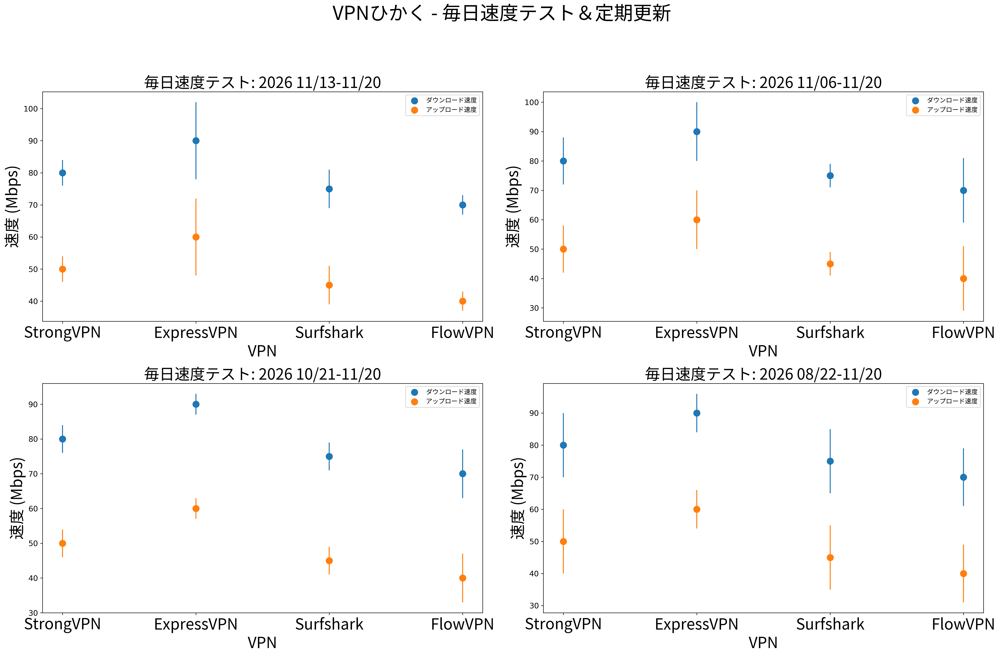

次に必要なのは、都市名を付けた同条件の経路テストです。今後は **米国西海岸→東京、米国東海岸→東京、欧州→東京** を、同じ端末・プロトコル・時間帯・元回線で比較し、VPNなしの基準値、VPN接続時のPing・ダウンロード・アップロード、再接続、20分の動画再生を記録する必要があります。その結果がそろうまでは、この図から東京の実測性能を断定しません。

StrongVPNが毎回最高速でなくても、目的の動画に十分な速度があり、初年度の料金が低ければ1位の理由は成立します。最高速度だけでなく、20分の連続再生、混雑時間、サーバー切り替え後の復帰まで確認してください。

## このサイトの結論：日本IPではなく「1年間の失敗コスト」で選ぶ

TVerやABEMAが開かない時、原因はVPNの速度だけとは限りません。日本IP、アカウント地域、端末の位置情報、Cookie、アプリのキャッシュ、決済国のどこで止まったかを切り分ける必要があります。高いVPNを買えば自動的に解決するわけでも、日本サーバーが多ければ必ず再生できるわけでもありません。

そのため、このページではStrongVPNを1位にしています。理由は「すべてで最強」だからではなく、現在の年間プランが月額4.99米ドル表示、初年度請求53.99米ドル、更新89.99米ドル/年という分かりやすい1年料金で、実際の日本向けサービスを試しやすいからです。自分の端末で合格すればそのまま使い、合わなければ返金期間中にExpressVPNへ移る。この順番なら、最初から高い料金を払う失敗を減らせます。

**順位の基準：** StrongVPNは1年の実用テスト、ExpressVPNは操作性とサポート、Surfsharkは家族・多数端末、FlowVPNは短期確認です。

## まず4社の違い

| 順位 | VPN | 向いている人 | 購入をやめる条件 |
|---:|---|---|---|
| 1 | [StrongVPN](https://strongvpn.com/jp/?tr_aid=60d96b5810e50&chan=w_github_jp&data1=jp-home&data2=hero) | 1年料金を抑え、海外から日本の動画や公共Wi-Fiを自分で試したい人 | メインの配信サービスが返金期間中に安定しない、または決済総額が想定と違う |
| 2 | [ExpressVPN](https://www.expressvpn.com/jp/top/country/japan-vpn?xvcid=yKMwqFWTfxyKWsB3AWwmhXdXUkpXYnRgxWVX3Q0&shareid=&irclickid=yKMwqFWTfxyKWsB3AWwmhXdXUkpXYnRgxWVX3Q0&irgwc=1&afsrc=1) | 料金よりアプリの完成度、サポート、切り替えの簡単さを優先する人 | StrongVPNで同じ用途を満たせており、追加料金の理由がない |
| 3 | [Surfshark](https://get.surfshark.net/aff_c?offer_id=323&aff_id=5585&source=w_github&aff_sub=jp) | 家族のスマホ、PC、テレビを多数同時に使う人 | 1〜2台しか使わない、または2年・長期前払いを避けたい |
| 4 | [FlowVPN](https://www.flowvpx.com/sign-up/?locale=ja-jp&special=FREETRIAL&r=35-890485.w_github) | 短期間で回線やWindowsアプリとの相性を見たい人 | 正確な終了時刻、試用後の請求額、解約方法を開始前に確認できない |

## 日本の動画が止まる場所を先に特定する

| 止まる場所 | 典型的な症状 | 最初に確認すること |
|---|---|---|
| VPN接続 | 日本サーバーにつながらない、速度が大きく落ちる | 別の日本サーバー、プロトコル、時間帯を試す |
| サービスのログイン | 日本IPでも地域エラーや認証エラー | アカウント国、決済地域、Cookie、DNSを確認 |
| 再生開始 | 番組ページは開くが本編が始まらない | ブラウザとアプリを分け、アプリを完全終了して再起動 |
| 連続再生 | ライブだけ止まる、画質が落ちる | 実際に使うテレビ・スマホで20〜30分確認 |

VPNは日本の住所や決済手段を作るサービスではありません。海外旅行中に既存の契約を使う場合と、新しく日本向けサービスへ契約する場合では条件が違います。各サービスの規約と公式サポート範囲も確認してください。

## 日本向けサービス別の合格条件

| サービス | 返金期間中に試すこと | 合格と判断する目安 |
|---|---|---|
| TVer / ABEMA | 日本サーバー、Cookie、位置情報、ライブと見逃し配信 | 番組ページだけでなく本編を20分以上再生できる |
| U-NEXT / Hulu Japan | ログイン、字幕、画質、混雑時間、別サーバー | いつも使う端末で作品が安定して再生できる |
| DAZN Japan | 試合開始時の遅延、画質、ピーク時間 | ライブ開始から途中まで大きな停止がない |
| Netflix / Disney+ / Prime Video | アカウント地域、作品検索、Fire TV・スマホアプリ | 目的の作品・字幕が実機で表示され、再生が続く |
| ホテル・空港Wi-Fi | ポータル認証後の接続、スリープ復帰、回線切り替え | VPNが予測どおり再接続し、メールや決済も安定する |

最初は[StrongVPN](https://strongvpn.com/jp/?tr_aid=60d96b5810e50&chan=w_github_jp&data1=jp-home&data2=jp_streaming_order)でこの合格条件を確認します。配信アプリが難しく、操作やサポートへ追加料金を払う意味がある時だけExpressVPNを検討するのが、このページの考え方です。

## 料金は「月額表示」ではなく支払総額で比較

目安レートは1米ドル約160円です。税金、為替、キャンペーン、更新料金は変わります。下表は、当サイトで記録しているオファーと2026年11月20日に確認できた公開価格を区別しており、最終金額は必ず決済画面で確認してください。

| VPN | 米ドルの目安 | 日本円の目安 | 判断 |
|---|---:|---:|---|
| [StrongVPN](https://strongvpn.com/jp/?tr_aid=60d96b5810e50&chan=w_github_jp&data1=jp-home&data2=price) | 月額4.99米ドル表示、初年度請求53.99米ドル、更新89.99米ドル/年 | 月額表示約800円、初年度約8,640円、更新約14,400円/年 | 1年だけなら分かりやすい低価格候補。ExpressVPNより安い |
| [ExpressVPN](https://www.expressvpn.com/jp/top/country/japan-vpn?xvcid=yKMwqFWTfxyKWsB3AWwmhXdXUkpXYnRgxWVX3Q0&shareid=&irclickid=yKMwqFWTfxyKWsB3AWwmhXdXUkpXYnRgxWVX3Q0&irgwc=1&afsrc=1) | Basic公開価格は月額2.99米ドル、最初の28か月83.72米ドル、以後99.95米ドル/年。税が加算される場合あり | 月額表示約480円、初回約13,400円、更新約16,000円/年 | 高くてもアプリ品質とサポートを優先する人向け |
| [Surfshark](https://get.surfshark.net/aff_c?offer_id=323&aff_id=5585&source=w_github&aff_sub=jp) | Starter公開価格は月額2.49米ドル、最初の27か月67.23米ドル。VAT・税が加算される場合あり | 月額表示約400円、初回約10,760円＋税 | 長期前払いと無制限端末を実際に使う場合に強い |
| [FlowVPN](https://www.flowvpx.com/sign-up/?locale=ja-jp&special=FREETRIAL&r=35-890485.w_github) | Affiliateページは短期トライアル。PayPalの事前承認後に開始し、解約しなければ有料契約へ移行。公開プランは月6.99米ドル、初年度39.99米ドル、更新49.99米ドル/年 | 月約1,120円、初年度約6,400円、更新約8,000円/年 | 短期テストや予備向け。開始前に正確な試用期間、試用後の請求額、PayPalでの解約方法を確認する |

**StrongVPNの決済確認：** 日本発行カードやPayPalを含め、実際に表示される支払い方法はチェックアウトで確認してください。カードが拒否された場合は、同じ操作を繰り返す前にカード会社、請求先住所、海外オンライン決済の設定を確認します。

## 購入後30分で行うこと

1. 決済画面で総額、契約期間、税金、更新料金、返金条件を保存する。
2. 一番よく使う端末に公式アプリを入れる。
3. StrongVPNの日本サーバーを2つ以上試す。
4. 目的のサービスを15〜20分再生し、字幕・画質・ライブも確認する。
5. 自宅Wi-Fiとスマホ回線を切り替え、再接続の動きを見る。
6. 合格なら継続。失敗なら返金期間内にExpressVPN、Surfshark、FlowVPNの役割に合わせて切り替える。

## StrongVPNを1位から外す条件

1位は固定広告ではありません。次の結果が出た場合は、役割に合う別のVPNへ切り替えます。

| 実機テストの結果 | 次に試すVPN | 理由 |
|---|---|---|
| TVer、ABEMA、U-NEXTなどの最重要サービスが複数サーバーで失敗する | ExpressVPN | 高い料金を払ってでも、アプリ操作やサポートの違いを試す意味がある |
| 家族のスマホ、PC、Fire TVなどを大量に同時接続したい | Surfshark | 無制限接続を使い切れる家庭なら、1台あたりの負担が下がる |
| 数日だけ回線との相性を確認したい | FlowVPN | 短期トライアルの目的と一致する。正確な期間と請求条件は開始前に確認する |
| 決済画面の総額、更新、返金条件がこのページと違う | いったん購入しない | 契約は比較表ではなく、決済直前の表示が優先される |

## 端末ごとに失敗の原因を分ける

| 端末 | よくある見落とし | 確認方法 |
|---|---|---|
| Windows / Mac | スリープ復帰後の再接続、キルスイッチ、別プロトコル | 公式アプリを使い、復帰後にIPとDNSを再確認する |
| iPhone / Android | 位置情報権限、モバイル回線への切り替え、アプリのキャッシュ | VPN接続後に配信アプリを完全終了して開き直す |
| Fire TV / Apple TV | テレビ側アプリ、アカウント地域、ルーター設定 | ブラウザの成功だけで判断せず、実際のテレビで再生する |
| ホテルWi-Fi | ポータル認証前にVPNをつないでしまう | 先にWi-Fi認証を完了し、その後VPNを接続する |

「日本サーバーあり」という一覧だけでは、この端末差は分かりません。StrongVPNを最初に試す理由は価格ですが、残す理由は自分の端末で合格したという結果です。

## 購入直前の3つの質問

**StrongVPNなら日本の動画を必ず見られますか？** いいえ。配信側の判定は変わるため、永久保証はできません。1年料金が分かりやすいので最初に試し、返金期間中の実機結果で継続を決めます。

**速度グラフの1位を買えばよいですか？** 最大値だけでは決められません。日本までの距離、プロトコル、混雑時間、共有IPの判定が違うため、目的のアプリを同じ時間帯に連続再生した結果を優先します。

**無料VPNではだめですか？** 低リスクの技術テストには使える場合があります。しかし、運営者、ログ、更新、サポートが不明な無料サーバーを、決済・仕事・主要アカウントに使うのは別のリスクです。

## 結論

海外から日本の配信を見たい人に必要なのは、抽象的な世界一ではなく、自分の日本向けサービスで合格する1台目です。1年料金を抑えて検証を始めるならStrongVPN、操作性とサポートに追加料金を払うならExpressVPN、家族の多数端末ならSurfshark、短期確認ならFlowVPN。この役割分担を崩さず、速度グラフと実機テストの両方で判断します。

当サイトはリンク経由の購入で報酬を受け取る場合があります。ただし、計測結果、決済条件、自分の端末で確認すべき項目は分けて記載しています。

<!-- NEWS_START -->
#### 2026年11月20日 VPN・プライバシー・サイバーセキュリティニュース
- **ExpressVPN が Amazon Vega OS 対応端末で利用可能に**：Fire TV Stick 4K Select を含む対応 Fire TV では、Amazon Appstore からアプリを入れ、リモコンで接続先を選択できます。[公式発表](https://www.expressvpn.com/blog/expressvpn-amazon-vega-os/)
- **Vega OS では一部 DNS クエリが VPN トンネル外に出る場合あり**：ExpressVPN は OS 側の挙動であり VPN アプリ全般に影響すると説明しています。暗号化された通信は影響を受けませんが、利用者は制限を把握しておく必要があります。[公式サポート情報](https://www.expressvpn.com/support/troubleshooting/dns-queries-vega-os/)
- **Proton VPN が新しいクライアント側プロトコル基盤をベータ公開**：Proton Protocols は Windows、Android、iOS/iPadOS、Linux のベータ版で試せ、安定性・検閲耐性・クロスプラットフォーム開発の改善を目指します。[公式発表](https://protonvpn.com/blog/introducing-proton-protocols)
- **ExpressVPN が 2026 年上半期の透明性レポートを公開**：同社によると VPN アクティビティや接続ログが開示された要請はゼロで、バグ報奨金制度では 392 件の提出中 42 件の固有報告が有効と判定されました。[公式レポート](https://www.expressvpn.com/blog/transparency-report-h1-2026/)
- **Mullvad Android 2026.9-beta1 に条件付きマルチホップを追加**：インタラクティブなサーバーマップ、設定に応じた自動 multihop、検索改善が含まれます。現時点では安定版ではありません。[公式変更履歴](https://github.com/mullvad/mullvadvpn-app/blob/main/android/CHANGELOG.md)
<!-- NEWS_END -->

## 日本向け実用ガイド

総合比較だけでは原因を切り分けにくいため、日本の動画配信で最も多い失敗を専用ページにまとめました。

- **海外から日本の動画を見る：** [TVer・ABEMAが海外で見られない時のVPN設定と確認手順](./tver-abema-vpn-overseas/)

「日本サーバーに接続したのに再生できない」場合は、VPNを買い替える前に、IP・Cookie・アプリストア地域・アカウント地域を順番に確認してください。専用ページでもおすすめ順は StrongVPN、ExpressVPN、Surfshark、FlowVPN のままです。

## 目次

### 1. [海外から日本のサービスを使う時の基本](#basics-of-unrestricted-access)
### 2. [比較するVPNの主なポイント](#key-features-of-recommended-global-vpns)
#### 2.1 [StrongVPN – 1年料金を比較しやすい候補](#strongvpn-recommendation)
#### 2.2 [ExpressVPN – 公式オファーと決済画面の価格](#expressvpn-12-months-+-3-months-free)
#### 2.3 [Surfshark – 無制限デバイス同時接続](#surfshark-unlimited-connections)
#### 2.4 [FlowVPN – 短期トライアル](#flowvpn-2-day-free-trial)
#### 2.5 [トップVPNのプライバシーポリシー比較](#privacy-policy-comparison-vpn-providers)
### 3. [StrongVPNの国際決済購入ステップ](#strongvpn-international-payment-tutorial)
#### 3.1 [StrongVPNスマホ（Android＆iOS）設定ガイド](#tutorial-de-configuracion-de-strongvpn-en-androidios)
### 4. [ExpressVPN購入ガイド – 割引プランの確認](#expressvpn-purchase-tutorial)
#### 4.1 [ExpressVPNインストールガイド – PC・スマホ・タブレット](#expressvpn-setup-tutorial)
### 5. [Surfsharkクイック購入ガイド（無制限デバイスプラン）](#surfshark-purchase-tutorial)
### 6. [FlowVPN 短期トライアル＆購入ガイド](#flowvpn-purchase-and-free-trial-tutorial)
### 7. [契約前に避けたいVPNの判断材料](#vpn-avoid-list)
### 8. [VPN選びの基準＆必須機能](#vpn-recommendation-standards-and-essential-features)
### 9. [誰でも知っておきたいVPNの基本知識](#essential-vpn-knowledge-you-need-to-know)
#### 9.1 [ダブルホップ／マルチホップVPN – 使い方とメリット](#double-multi-hop-vpn-uses-benefits)
#### 9.2 [VPNがネット速度に与える影響](#vpn-impact-on-network-speed)
#### 9.3 [「アクセスツール」と「本物のVPN」の違い](#differences-between-access-software-and-vpns)
#### 9.4 [VPN契約を定期的に見直す方法](#how-to-rotate-vpn-providers-for-better-security)
### 10. [VPNでできること＋大事な注意点](#what-you-can-do-with-a-vpn-and-precautions)
### 11. [よく使われるVPNプロトコルとツール紹介](#introduction-to-common-vpn-protocols)
#### 11.1 [VPN vs Tor：違いと使い分け](#differences-and-use-cases-vpn-vs-tor)
#### 11.2 [VPN vs プロキシサーバー：決定的な違い](#differences-between-vpn-and-proxy-servers)
### 12. [VPNサーバー分析 – 実践Tipsと気づき](#vpn-server-analysis-practical-tips)
#### 12.1 [VPN接続がよく切れる時の対処法](#how-to-fix-vpn-connection-drops)
#### 12.2 [VPNを常に安定して繋ぎ続けるコツ](#how-to-keep-vpn-always-active)
### 13. [無料VPNを選ぶ前に確認すること](#risks-of-free-vpns-why-we-dont-recommend-them)
### 14. [自前VPNを運用する時の現実](#why-not-build-your-own-vpn)
### 15. [ゲームで確認するVPNの経路・Ping・安定性](#vpn-features-for-gaming)
### 16. [VPNで配信サービスを確認する手順](#guide-to-streaming-with-vpn)
#### 16.1 [NetflixとHuluがVPNをどう検知・ブロックするか](#how-netflix-and-hulu-detect-and-block-vpns)
### 17. [詳細VPN速度リファレンス（毎日更新 – 2026年11月20日）](#detailed-vpn-speed-test-report)
#### 17.1 [大陸別接続リファレンス](#vpn-connection-success-rates-by-continent)
#### 17.2 [世界各地の速度リファレンス](#vpn-speed-tests-global-regions)
#### 17.3 [Netflix大陸別接続リファレンス](#netflix-connection-success-rates-by-continent)
#### 17.4 [Disney+大陸別接続リファレンス](#disney-plus-connection-success-rates-by-continent)
### 18. [LinuxでのVPNインストールガイド](#vpn-installation-tutorial-on-linux)
### 19. [VPNをブロック・制限するアプリとサービス](#apps-and-services-that-may-block-vpns)
### 20. [BitTorrent＋VPNの設定とベストプラクティス](#bittorrent-with-vpn-setup-tips)
### 21. [FlowVPNのApple TV対応を確認する](#vpn-for-apple-tv)
### 22. [VPNのよくある制限と解決策](#vpn-limitations-and-solutions)

## このページの読み方

このページは、海外から日本の動画サービスを利用する時に、どこで失敗したかを切り分けるための比較ガイドです。価格、契約期間、対応端末、公式文書、返金・試用条件を更新し、速度画像は同じ4社を見比べるための参考資料として掲載しています。

速度画像だけで「東京で最速」「TVerが必ず見られる」とは判断しません。東京までの経路は、出発地、ISP、サーバー、プロトコル、時間帯で変わります。米国西海岸・米国東海岸・欧州から東京への同条件テストは、今後追加すべき検証項目です。

## VPNの状況は回線と用途で変わる

配信サービスは共有IP、Cookie、位置情報、アカウント地域、決済地域などを組み合わせて判定します。VPNアプリが接続済みでも、動画が再生できるとは限りません。Windows更新や配信側の仕様変更で一時的な不具合が起きる場合もあるため、問題が出た日は次の順で確認します。

1. VPNを切った状態で元回線が正常か確認する。
2. 公式アプリを最新版にし、同じ国の別サーバーを試す。
3. ブラウザと配信アプリを分けて確認する。
4. Cookie、位置情報、アカウント地域を確認する。
5. 解決しない場合は、返金・試用期限内にサポートへ問い合わせる。

StrongVPNは1年料金を抑えて実機確認を始める候補、ExpressVPNはアプリとサポートへ追加料金を払う候補、Surfsharkは多数端末を使う家庭向け、FlowVPNは短期確認向けという役割で比較します。順位は万能性の宣言ではなく、失敗した時の費用と切り替えやすさを基準にしています。

## 海外から日本のサービスを使う時の基本

### 地域制限とネットワーク制限は別の問題

日本の動画が海外で見られない主な理由は、作品ごとの配信権とサービスの提供地域です。一方、ホテル、学校、会社、空港などでは、ネットワーク管理者が特定の通信やポートを制限している場合があります。同じ「つながらない」でも原因が違うため、地域、端末、アプリ、ネットワークを一つずつ変えて確認します。

VPNは接続先から見えるIPアドレスをVPNサーバーのものへ変え、端末とVPNサーバーの間を暗号化します。ただし、ログイン中のアカウント、ブラウザの識別情報、GPS、アプリストア地域、決済地域まで自動的に変更するものではありません。利用する国の法律と各サービスの規約も確認してください。

### 旅行前に準備すること

- 公式サイトまたは公式アプリストアからアプリを導入する。
- ログイン、更新、二段階認証を出発前に済ませる。
- 返金期限、更新料金、サポート窓口を保存する。
- 必要な日本サーバーと動画サービスを一度試す。

### 公共Wi-FiでVPNを使う時

ホテルや空港では、先にWi-Fiのポータル認証を完了してからVPNへ接続します。VPNは端末からVPNサーバーまでの通信保護に役立ちますが、フィッシング、マルウェア、危険なダウンロード、ログイン先サービスの追跡まで防ぐものではありません。HTTPS、OS更新、二段階認証も併用してください。

### 主なプロトコルの見方

- **WireGuard**：速度と実装の軽さを重視する時の第一候補。
- **OpenVPN**：幅広い環境で使われ、UDPとTCPを切り替えられる場合がある。
- **IKEv2/IPsec**：Wi-Fiとモバイル回線の切り替え後に再接続しやすい場合がある。
- **PPTP**：古く、安全性が必要な用途には選ばない。

## 比較時に確認するVPNの条件

購入前のスペック表より、返金・試用期間中に確認できる項目を重視します。

- 必要な国と端末に現在対応しているか。
- 自宅回線と外出先で接続・再接続が安定するか。
- 目的の動画、仕事用アプリ、Webサイトが実際に動くか。
- キルスイッチや自動接続が自分のOSで意図どおり動くか。
- プライバシーポリシー、監査、保存データの範囲を確認できるか。
- 初回総額、税、更新料金、返金・試用条件が明確か。
- 問題が起きた時に利用できるサポート窓口があるか。

この条件を同じ順番で確認すると、広告の最大速度やサーバー数だけで選ぶ失敗を減らせます。

### 1. [StrongVPN – 1年料金を比較しやすい候補](https://strongvpn.com/jp/?tr_aid=60d96b5810e50&chan=w_github_jp&data1=jp-home&data2=title)

**StrongVPN** を1位にしている理由は、現在の年間プランが月額4.99米ドル表示、初年度請求53.99米ドル、更新89.99米ドル/年という1年料金だからです。約160円/米ドルなら月額表示約800円、初年度約8,640円、更新約14,400円/年ですが、税、為替、最終料金は決済画面で確認してください。 

デスクトップ、スマホ、テレビ、ルーター向けのアプリや設定情報があります。動画サービスの対応状況は変わるため、サービス名だけで購入せず、返金期間中に目的のアプリで再生まで確認します。

WireGuard、OpenVPN、IKEv2など複数の接続方式に対応しています。サーバー数、対応地域、返金条件、サポート時間は変更される可能性があるため、購入時の公式表示を優先します。

プライバシーについては「ノーログ」という短い宣伝文句だけで判断せず、現在のプライバシーポリシー、管轄、保存されるアカウント情報を確認してください。

#### StrongVPNの実際の速度ってどうなの？

速度はプロトコル名や最大値だけでは判断できません。東京までの経路、元回線、時間帯、混雑、端末で結果が変わります。現在の図は4社を同じ形式で見るための参考資料であり、東京の都市別実測を示すものではありません。

StrongVPNを残すかは、返金期間中に次の条件で判断します。

- VPNなしのPing・ダウンロード・アップロードを先に記録する。
- 同じ端末で日本サーバーを2つ以上試す。
- WireGuardと別の対応プロトコルを同じ時間帯に比較する。
- TVer、ABEMAなど目的のサービスを20分以上再生する。
- Wi-Fi切り替え後の再接続と、切断時の挙動を確認する。

米国西海岸・米国東海岸・欧州から東京への同条件データがそろうまでは、特定都市で最速とは書きません。

### StrongVPNの主な強みまとめ

- 1年プランの初回総額と更新額を分けて比較しやすい
- Windows、macOS、iOS、Android、Linux、ルーターなど複数の利用方法を案内している
- 最大12台の同時接続を案内しているため、実際に使う端末数と比較できる
- WireGuard、OpenVPN、IKEv2など複数の接続方式から試せる
- 返金条件とサポート窓口があるため、購入後に実機確認できる
- 支払い方法、サーバー数、対応地域、付帯サービスは購入時の公式表示を優先する

| 項目 / スペック                  | StrongVPN                              |
|----------------------------------|----------------------------------------|
| 対応クライアント                 | Windows, macOS, Linux, Android, iOS, DD-WRT, GL.iNetルーター, Android TV |
| 対応プロトコル                   | OpenVPN, L2TP/IPsec, SSTP, WireGuard   |
| サーバー数                       | 950+                                   |
| 対応国数                         | 30+                                    |
| 本社 / 管轄地域                  | アメリカ合衆国                         |
| 支払い方法                       | 主要クレジット／デビットカード、PayPal（チェックアウト表示を優先） |
| 本人確認 / ID提出必要？          | 不要                                   |
| 暗号化プロトコル                 | WireGuard, OpenVPN, IKEv2, L2TP, SSTP  |
| データ量 / 帯域制限              | 無制限                                 |
| 使用制限                         | 無制限                                 |
| 同時接続台数                     | 12台                                   |
| カスタマーサポート               | メール, 24/7ライブチャット, 電話       |
| プライバシーポリシー             | 厳格ノーログ（ゼロログ）               |

コスパ重視で1年以内に使うなら、StrongVPNは最初に確認したい選択肢です。  
まずは料金、対応端末、返金条件を確認して、自分の回線で試すのが現実的です。

### 2. [ExpressVPN – プレミアムVPN公式オファー](https://www.expressvpn.com/jp/top/country/japan-vpn?xvcid=yKMwqFWTfxyKWsB3AWwmhXdXUkpXYnRgxWVX3Q0&shareid=&irclickid=yKMwqFWTfxyKWsB3AWwmhXdXUkpXYnRgxWVX3Q0&irgwc=1&afsrc=1)

**ExpressVPN** は、アプリの分かりやすさ、サポート、ルーターを含む対応範囲を重視する人向けのプレミアム候補です。このページでは、StrongVPNで用途を満たせない時に追加料金を検討する2番手としています。

Windows、macOS、Android、iOS、Linuxはもちろん、ルーター、Apple TV、Fire TV、PlayStation、Chromebook、Kindle、スマートTVまでネイティブアプリや詳細ガイドが揃ってる。  
公式アプリは暗号化、Lightway、Network Lockなどの機能を案内しています。ただし、OS、設定、スプリットトンネル、アプリ更新によって挙動は変わるため、DNS/IP確認と切断時の動作を自分の端末で確認します。

対応国やロケーションは多いものの、サーバー数だけで日本の動画再生や低遅延を保証することはできません。公式のロケーション一覧、監査情報、対応端末を確認し、実際に使う日本サーバーと配信アプリで判断してください。

主なトレードオフは価格です。アプリやサポートの差が自分の問題を解決する場合にのみ、追加料金を払う理由があります。

#### ExpressVPNの主な強みまとめ

- 対応国、端末、ルーター設定に関する公式ガイドが多い
- Lightway、OpenVPNなど複数の接続方式を選べる
- ライブチャットとメールのサポート窓口を案内している
- 返金条件があるため、目的の日本サーバーと配信アプリを購入後に確認できる
- 支払い方法、同時接続台数、ロケーション数はプランと時期で変わるため、公式表示を確認する

**価格メモ**：2026年11月17日に確認できたBasic公開価格は、月額2.99米ドル表示、最初の28か月83.72米ドル（約13,400円）、以後99.95米ドル/年（約16,000円）です。税、12か月・月払い・地域別価格はリンク先で確認してください。 
クレカ、PayPal、Bitcoinなど対応。  

**購入前の注意**：モバイルアプリの無料トライアル表示は、地域・アプリストア・時期によって異なります。チェックアウト画面で対象条件を確認し、返金保証を使う場合も期限と手続きを先に読んでください。

| 項目                           | ExpressVPN                                      |
|--------------------------------|-------------------------------------------------|
| 接続ロケーション               | 214以上                                         |
| 対応国数                       | 113                                             |
| 対応プラットフォーム           | Windows, macOS, iOS, Android, Linux, BlackBerry, Kindle Fire, Nook, ルーター, ゲーム機（MediaStreamer経由）, Amazon Fire TV, Apple TV, Chromebook, Windows Phone など |
| 同時接続台数                   | 最大14台（プランによる：Basic 10 / Advanced 12 / Pro 14） |
| スプリットトンネリング         | 対応                                            |
| キルスイッチ                   | 対応（Network Lock）                            |
| 対応プロトコル                 | Lightway（自社高速）、OpenVPN UDP/TCP, L2TP/IPSec, IKEv2 |
| 本社 / 管轄地域                | 英領ヴァージン諸島（プライバシー保護に最適）     |
| カスタマーサポート             | 24/7ライブチャット、メール、豊富な知識ベース     |

このページでは、1年料金を抑えたい人はStrongVPNを先に試します。より高い料金でもアプリの完成度やサポートを重視する場合はExpressVPN、端末数が多い場合はSurfshark、短期の相性確認にはFlowVPNという順で判断します。

### 3. [Surfshark – 同時接続無制限の高コスパ](https://get.surfshark.net/aff_c?offer_id=323&aff_id=5585&source=w_github&aff_sub=jp)

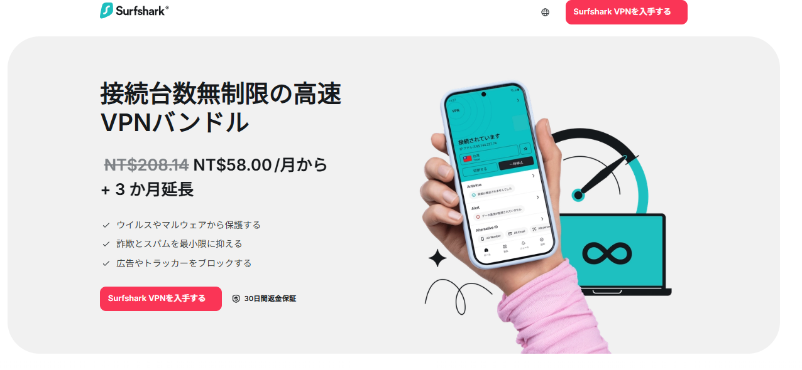

**Surfshark** は、家族や複数端末で同時に使う人向けの候補です。最大の違いは同時接続台数であり、1〜2台しか使わない場合は長期前払いの利点が小さくなります。

Windows、macOS、iOS、Android、Linux、ブラウザ拡張、Smart DNSなど幅広い環境を案内しています。サーバー数とロケーションは変更されるため、必要な国と端末が現在の公式一覧にあるか確認してください。

WireGuard、OpenVPN、キルスイッチなどの機能を提供し、現在の運営拠点はオランダです。プライバシーを重視する場合は、広告文ではなく最新ポリシーと監査情報を確認してください。

動画サービスへの接続は変動するため、Netflix、Amazon Prime、Disney+、Huluなどを常時利用できるとは限りません。必要なサービスを返金期間中に確認してください。

#### Surfsharkの主な強みまとめ

- **同時接続無制限**のため、多数の端末を使う家庭では1台あたりの費用を比較しやすい
- Windows、macOS、iOS、Android、Linux、テレビ向けの対応状況を公式一覧で確認できる
- WireGuard、OpenVPN、キルスイッチなど、購入前に確認したい基本機能がある
- 長期プランは月額表示が低くなりやすい一方、初回総額と更新額を分けて見る必要がある
- 返金条件、支払い方法、監査資料は購入時の公式表示で確認する

家族や複数デバイスで使う人には比較しやすい候補です。長期総額を先に支払っても無制限接続を使い切れるかで判断してください。

### 4. [FlowVPN – 短期トライアル](https://www.flowvpx.com/sign-up/?locale=ja-jp&special=FREETRIAL&r=35-890485.w_github)

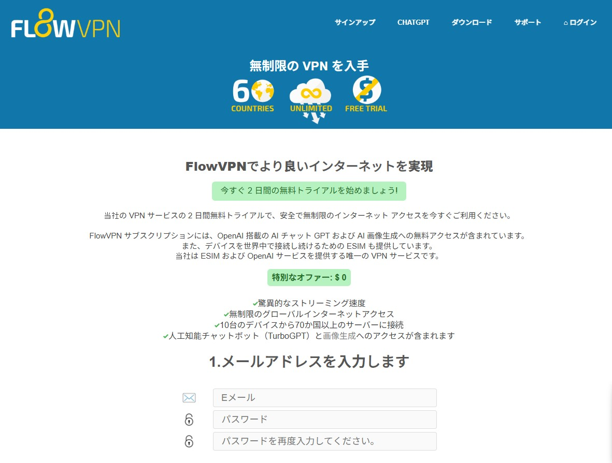

**FlowVPN** の役割は、短期トライアルで自分の回線と端末の相性を確認することです。案内ページによって試用期間の表記が一致しない場合があるため、開始画面に表示される正確な終了時刻、試用後の請求額、PayPalの事前承認と解約方法を確認してください。

速度は地域、時間帯、サーバーで変わります。上のグラフは比較の基準として使い、実際に使うWindows、スマホ、動画サービスで試用期間中に確認します。

#### FlowVPNの主な強みまとめ

- 短期トライアルで、自分の回線と見たいサービスを先に確認できる
- Windows、macOS、iOS/iPadOS、Android向けアプリを案内している
- 複数のプロトコルを提供しているが、現在使える方式は端末ごとに公式アプリで確認する
- サーバー地域、同時接続台数、学生向け条件は変更される可能性があるため、登録画面を優先する

短期間で相性を判断できる人向けです。継続前に実際の請求額と更新条件をもう一度確認してください。

### プライバシーポリシー比較：確認する資料と範囲

プライバシーは宣伝文句だけでなく、何を保存しないのか、どのアカウント・決済・診断情報を保存するのか、監査の対象と日付は何かを分けて確認します。このガイドでは、料金や端末数とは別の評価項目として扱います。

#### ExpressVPN
本社は英領ヴァージン諸島です。ExpressVPNはノーログ方針、監査、TrustedServerに関する資料を公開していますが、監査の対象範囲と日付を確認し、アカウント・請求情報まで何も保存されないという意味に広げないでください。

#### StrongVPN
本社は**アメリカ合衆国**（ニューヨーク）。  
ノーログ方針を公開していますが、米国管轄であることと第三者監査の有無は分けて確認します。保存されるアカウント・決済情報を含め、最新のプライバシーポリシーを購入前に読んでください。

#### Surfshark
本社は**オランダ**です。ノーログ方針、監査、透明性に関する資料を公開しています。保存されるアカウント・決済・診断情報と、監査が確認したシステムの範囲は、最新の公式文書で確認してください。

| 項目                             | ExpressVPN                     | StrongVPN                  | Surfshark                      |
|----------------------------------|--------------------------------|----------------------------|--------------------------------|
| 本社 / 管轄地域                  | 英領ヴァージン諸島             | アメリカ合衆国             | オランダ（GDPR準拠）           |
| ブラウジング/活動/IPログ         | なし（厳格ノーログ、複数監査） | なし（ゼロログ）           | なし（厳格ノーログ、複数監査） |
| 第三者へのデータ共有             | 法廷命令以外なし               | 法廷命令以外なし           | 法廷命令以外なし               |

**結論**：監査資料を重視する場合はExpressVPNとSurfsharkを詳しく確認し、1年料金を重視する場合はStrongVPNのポリシーと管轄を理解したうえで比較します。最新ポリシーは各公式サイトで直接確認してください。

## 実践ガイド：StrongVPNの国際決済購入手順＆ExpressVPNセットアップ（全デバイス対応）

## StrongVPN – 国際決済の確認手順

**決済情報：** 日本発行カードやPayPalを含め、利用できる方法はチェックアウトの最新表示を優先します。総額、税、更新額、請求先住所を送信前に確認してください。

### Step 1: 限定割引リンクから入る
割引ページはこちら：[StrongVPN](https://strongvpn.com/jp/?tr_aid=60d96b5810e50&chan=w_github_jp&data1=jp-home&data2=title) → 「Start Now」をクリック（下のスクショ見てね）。  

### Step 2: サイト繋がらない・購入失敗時の回避策
ページが開かない場合は、URL、ブラウザ、DNS、現在接続中のVPNやセキュリティソフトを確認します。別のVPNを契約して購入画面へ入ることを前提にしないでください。  
1年プランは月額4.99米ドル表示（約800円）、初年度請求53.99米ドル（約8,640円）、更新89.99米ドル/年（約14,400円）です。1年以内の有料VPNとしてはStrongVPNが低価格で分かりやすく、ExpressVPNより明確に安いです。 
更新時は価格が変わることがあるため、更新前に公式ページで条件を確認してください。

### Step 3: 支払い方法を選ぶ
支払いセクションまでスクロール。  
表示されたクレジット／デビットカードまたは**PayPal**を選び、カード名義、請求先住所、総額、更新額を送信前に確認します。

### StrongVPNをモバイル（Android & iOS）でセットアップする手順

スマホでは、公式アプリを入れた後に接続先、再接続、切断時の挙動を確認します。

#### 1. アカウント作成＆購入
上のリンクで1年プランの初回総額、更新額、返金条件を確認してからアカウントを作成します。

#### 2. Androidインストール＆接続
- Google Playで「StrongVPN」検索 → 「インストール」
- アプリ開いてユーザー名・パスワード入力 → 「Log In」
- 「Best Available Location」で最速自動接続、または国・サーバー手動選択

#### 3. iOS（iPhone/iPad）インストール＆接続
- App Storeで「StrongVPN」検索 → 「入手」
- アプリ起動してログイン
- 「Best Available Location」で最適自動接続、またはリストからサーバー選ぶ

接続後はIPとDNSを確認し、切断時の挙動も試します。動画、ブラウザ、ゲームはそれぞれ別に動作を確認してください。

## ExpressVPN 購入ガイド – 割引プランを確認

**注意**：利用できるカード、PayPalなどの支払い方法は地域とチェックアウトで変わります。別のVPNを契約して購入ページへ入ることを前提にせず、ページが開かない場合は現在のVPNやプロキシを切り、別ブラウザや自宅・モバイル回線を試してください。
**確認ポイント**：このリンクで表示される契約期間、初回総額、税、更新額、返金条件を購入直前に保存します。

### Step 1: ExpressVPNのオファーを確認
現在のプランはこちら：[ExpressVPN Deal](https://www.expressvpn.com/jp/top/country/japan-vpn?xvcid=yKMwqFWTfxyKWsB3AWwmhXdXUkpXYnRgxWVX3Q0&shareid=&irclickid=yKMwqFWTfxyKWsB3AWwmhXdXUkpXYnRgxWVX3Q0&irgwc=1&afsrc=1)。公式ページの「Get ExpressVPN」から契約期間と総額を確認します。
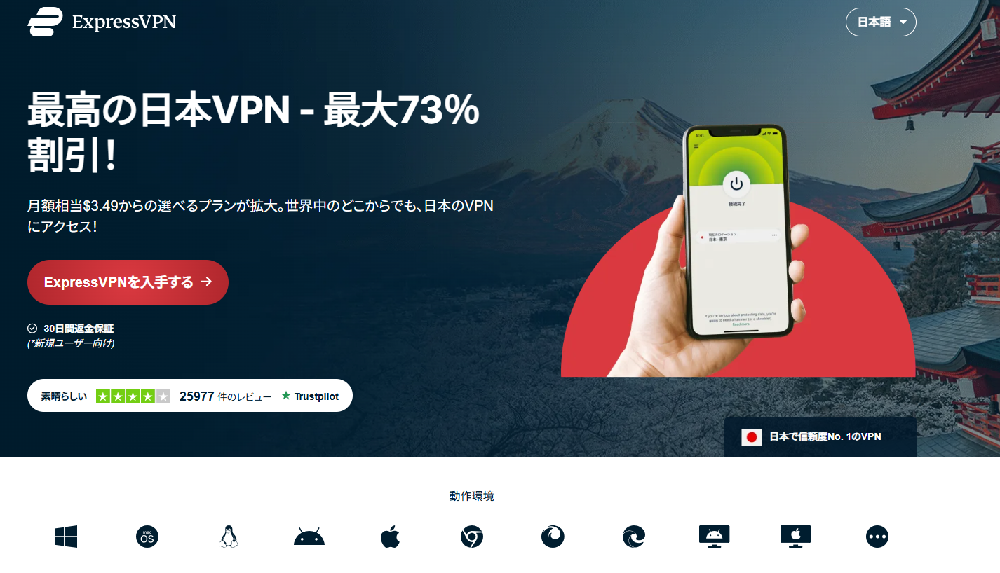

| プラン期間              | 総額       | 月額換算                   |
|-------------------------|------------|-----------------------------|
| 1ヶ月                   | $12.95    | $12.95                      |
| 6ヶ月                   | $59.95    | $9.99                       |
| 公式オファーの最新価格 | 決済画面で確認 | 国、税金、為替、プラン構成、キャンペーンで変動 |

### Step 2: 公式ページで現在のプランを確認
公式ページでは時期により複数のプランやキャンペーンが表示されます。月額換算だけでなく、合計請求額、更新価格、返金条件を確認してください。  
（更新時は価格やキャンペーン条件が変わることがあります）  
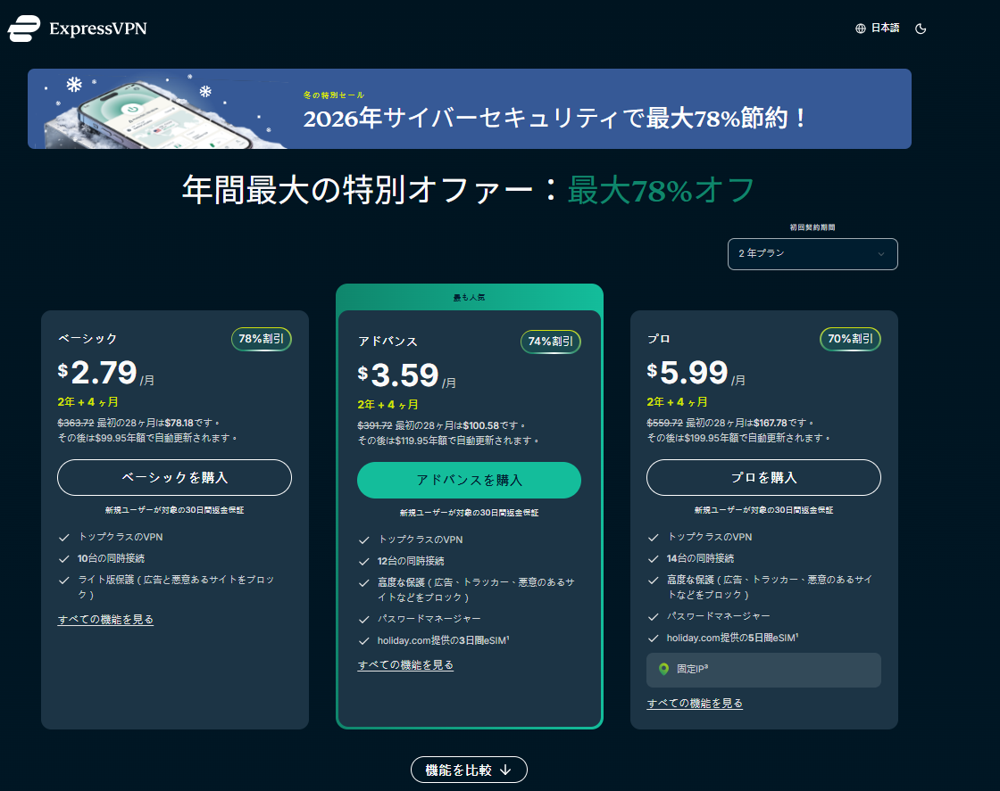

### Step 3: メール＆支払い入力
ログインと確認に使うメールアドレスを入力します。支払い方法は地域と決済画面で変わるため、表示された方法、請求通貨、総額、更新額を確認してから送信します。
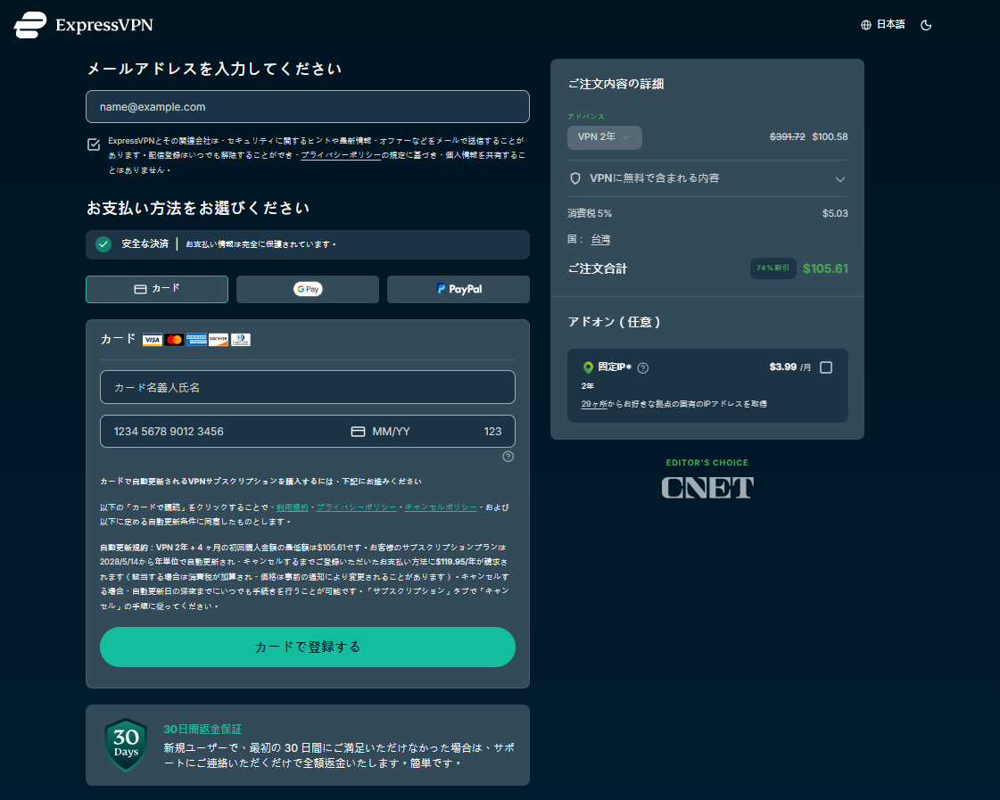

## ExpressVPN セットアップガイド – PC・モバイル・タブレット

所要時間は端末とネットワーク設定で変わります。必ず公式アプリまたは公式設定ファイルを使います。

#### 1. 購入＆アカウント作成
上のリンクから現在表示されるプランを選び、合計額と返金条件を確認してからアカウントを作ってください。

#### 2. PC（Windows/macOS）インストール＆接続
- ExpressVPNサイトにログイン → OS対応アプリダウンロード
- インストーラー実行して簡単セットアップ
- アプリ開いてログイン → 「Smart Location」で自動最速接続、または手動サーバー選択

#### 3. モバイル（Android/iOS）インストール＆接続
- スマホからサイト訪問（orアプリストア検索） → 公式アプリダウンロード
- 起動してログイン
- 「Smart Location」で即最適接続、または国・サーバーリストから選ぶ

#### 4. タブレット（iPad/Androidタブレット）インストール＆接続
- モバイルと同じ：サイトからアプリDL（orストア）
- ログイン → 「Smart Location」or手動で接続

導入後はIP、DNS、再接続、キルスイッチの範囲を確認し、よく使うサービスを実際に試してください。

これで主要なプラン確認とセットアップ手順は完了です。  
購入前に返金保証の条件、対応デバイス、更新料金を確認して、自分の使い方に合うか落ち着いて判断しましょう。  
ここまで確認すれば、購入前に見るべきポイントを整理できます。

## Surfshark＆FlowVPNの購入・お試しガイド

## Surfshark – 同時接続無制限の家族向けプラン

### Step 1: Surfsharkの長期プランを確認
現在のプランはこちら：[Surfshark – 無制限接続](https://get.surfshark.net/aff_c?offer_id=323&aff_id=5585&source=w_github&aff_sub=jp)。公式ページの「Get Surfshark」から契約期間と総額を確認します。

### Step 2: 契約期間と総額を確認
長期プランはキャンペーンで大きく割引されることがあります。現在のStarter公開価格は月額2.49米ドル表示、最初の27か月67.23米ドル（約10,760円）+税です。更新価格、日本円の実額、税金、為替は変わるため、決済画面の総額を確認してください。 
（更新時は価格やキャンペーン条件が変わることがあります）  
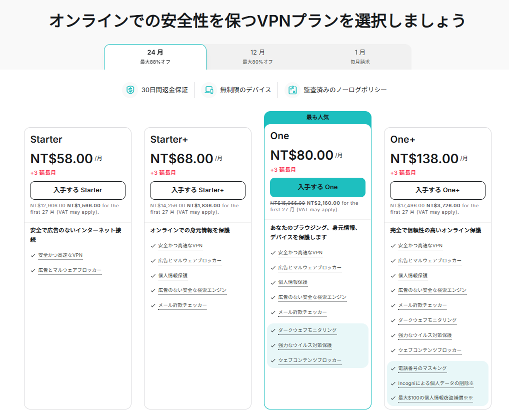

### Step 3: メール入力＆支払い完了
ログインと確認コードに使うメールアドレスを入力します。利用できる支払い方法は地域によって変わるため、決済画面に表示された方法、通貨、税、初回総額、更新額を確認します。
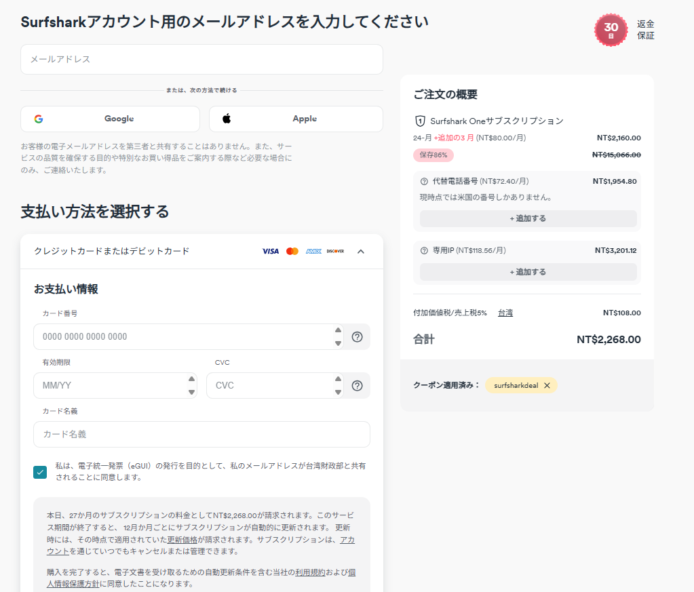

購入後は必要な端末へ導入し、速度、切断時の保護、目的のアプリを確認します。

## FlowVPN – 短期トライアル＆購入ガイド

FlowVPNは短期間で相性を確認したい人向けです。案内ページによって試用期間の表記が一致しない場合があるため、PayPalの事前承認前に、画面へ表示される正確な終了時刻、試用後の請求額、解約方法を確認します。

### Step 1: 無料トライアルスタート
登録画面はこちら：[FlowVPN – 短期トライアル](https://www.flowvpx.com/sign-up/?locale=ja-jp&special=FREETRIAL&r=35-890485.w_github)
メールアドレスとパスワードを入力し、PayPalに表示される試用後の請求額と解約条件を確認して事前承認します。
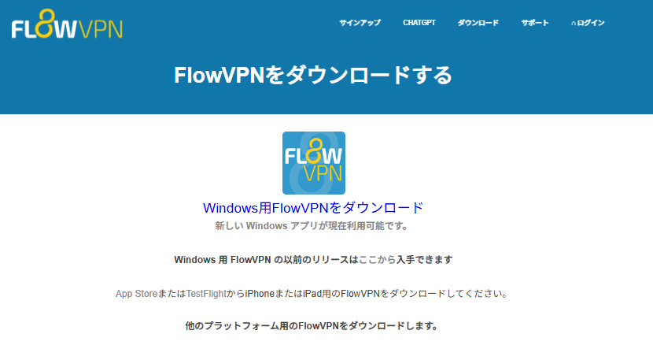

### Step 2: 人間確認（Captcha）
画面の指示に従って画像などを選び、人間による操作であることを確認します。
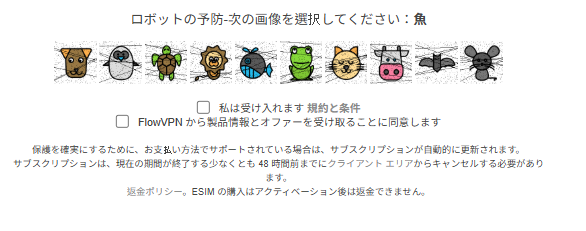

### Step 3: 公式アプリをダウンロードして確認
登録後、公式ダウンロードページへ：https://www.flowvpx.com/download/  
デバイスに合ったアプリ（Windows/macOS/Android/iOS）を選んでインストールし、登録したアカウントでログインします。
試用中に必要な端末とサービスを確認し、継続しない場合は期限前にPayPalの自動支払いを解約します。
[FlowVPNの短期トライアル条件を確認する](https://www.flowvpx.com/sign-up/?locale=ja-jp&special=FREETRIAL&r=35-890485.w_github)

### FlowVPNで開始前に確認すること

- 登録画面に表示される正確な試用期間と終了時刻
- PayPalで事前承認される試用後の請求額と更新条件
- 必要な端末、国、プロトコルが現在のアプリで利用できるか
- 継続しない場合の解約場所と期限
- 自分の回線での接続、再接続、目的のアプリの動作

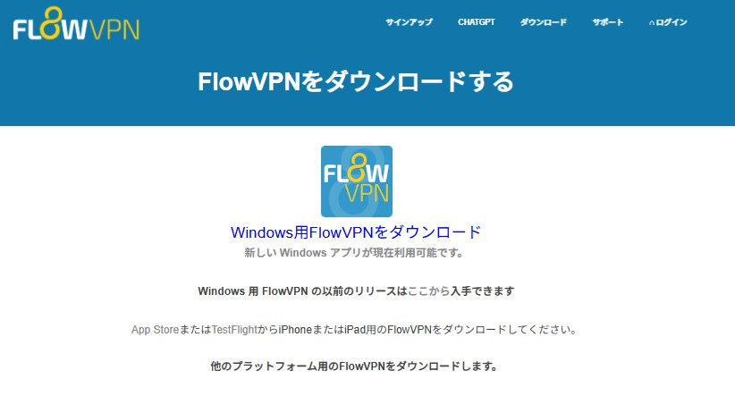

## VPNが接続できない時の切り分け

接続障害は、元回線、Wi-Fi認証、VPNサーバー、プロトコル、アプリ更新、OS設定のどこでも起こります。複数のVPNを急いで契約する前に、次の順で一つずつ確認します。

1. VPNを切り、元回線と目的のサービスが正常か確認する。
2. ホテルや空港ではWi-Fiのポータル認証を先に完了する。
3. 同じ国の別サーバーへ切り替える。
4. WireGuard、IKEv2、OpenVPNなど、アプリが提供する別プロトコルを試す。
5. アプリとOSを更新し、端末を再起動する。
6. 目的の動画やアプリを再確認し、解決しなければ期限内にサポートへ連絡する。

### 契約を避ける判断材料

事業者名だけで危険・安全を断定するのではなく、現在確認できる証拠で判断します。次のいずれかに当てはまる場合は、契約やインストールを止めてください。

- 運営会社、連絡先、利用規約、プライバシーポリシーが確認できない。
- 公式サイトとアプリストアの開発者名が一致しない。
- APK、EXE、構成ファイルを非公式な配布元から入れるよう求められる。
- 初回総額、更新額、解約方法、返金条件が決済前に分からない。
- 「すべての動画が必ず見られる」「完全匿名」「速度低下ゼロ」など、検証できない保証をする。
- 無料サービスなのに、サーバー運営費を何で賄うか、どのデータを収集するか説明がない。
- アプリや公式文書が長期間更新されず、サポートへ連絡できない。

無料・有料、大手・小規模を問わず同じ基準で確認します。StrongVPN、ExpressVPN、Surfshark、FlowVPNについても、購入時の公式表示と自分の端末での結果がこのページより優先されます。

## VPN選びの基準と確認したい機能（2026年版）

VPN選びではスペック表だけでなく、自分が必要とする国・端末・サービスで使えるかが重要です。  
ここでは、契約前と返金・試用期間中に確認したい基準をまとめます。

### 信頼できるVPNを選ぶための基準

1. **運営者と保守状況を確認できる**
   会社情報、サポート窓口、利用規約、プライバシーポリシー、アプリ更新履歴が確認できることを重視します。会社の規模だけで安全性や接続品質が決まるわけではありません。

2. **用途と利用条件を同じ手順で確認**  
   必要な国、サーバー、端末が現在の公式一覧にあるか確認します。  
   古い機能表だけで判断せず、公式ページ、アプリ対応、返金・試用条件を購入直前にもう一度確認します。

### 必須機能の詳細チェックポイント

1. **必要な端末への対応**
   Windows、macOS、Android、iOSに加え、Linux、ルーター、Fire TV、Apple TVなど、自分が使う端末の現在の対応方法を確認します。GUI、コマンドライン、手動設定のどれになるかも購入前に確認してください。

2. **同時接続台数**  
   インストールできる台数と、同時に接続できる台数は別です。StrongVPN、ExpressVPN、FlowVPNは現在のプラン上限を確認し、Surfsharkは無制限接続を実際に使い切れるかで総額を比較します。

3. **スプリットトンネリング**  
   特定アプリだけVPNを通し、他を通常回線へ分けられる機能です。  
   例：TVer、ABEMA、銀行アプリなどは通常接続のまま、NetflixやDisney+、海外スポーツ配信だけVPN経由にする。速度落ちを抑えたい人に便利です。

4. **帯域・データ上限**
   4K動画や大容量通信を使う場合は、データ上限、公平利用条件、速度制御の記載を確認します。「無制限」と書かれていても、すべてのサーバーが常に混雑しないという意味ではありません。

5. **24時間ライブチャットサポート**  
   問題発生時にライブチャットやメールで対応できるか、サポート時間と言語を確認します。

6. **30日全額返金保証**  
   返金保証は自分の地域と端末で確認する機会になります。対象条件、期限、申請方法を先に読んでください。

### 高度プライバシー＆セキュリティ機能

7. **保存データの範囲が分かるプライバシーポリシー**
   活動ログだけでなく、接続情報、診断情報、アカウント、決済データの扱いを分けて読みます。監査がある場合は、対象システムと実施日も確認します。

8. **国際決済対応**  
   海外クレカ、PayPal、Bitcoin、Google Pay、Amazon Payなど柔軟なほど便利。

9. **現在保守されている暗号化と実装**
   暗号方式の名称だけでなく、安全な初期設定、鍵管理、DNS/IP漏れ対策、アプリ更新を確認します。

10. **用途に合うプロトコル**
    WireGuardは効率を重視する場合、OpenVPNは広い互換性、IKEv2はモバイル回線切り替え後の再接続で候補になります。Lightwayなど独自方式も含め、同じ回線で比較してください。PPTPは安全性が必要な用途では選びません。

11. **自動接続とキルスイッチ**
    自動接続は意図しない通常回線の利用を減らします。キルスイッチの対象範囲はOSとアプリで違うため、VPN接続を意図的に切って挙動を確認してください。

候補はStrongVPN（1年料金）、ExpressVPN（プレミアムなアプリとサポート）、Surfshark（多数端末）、FlowVPN（短期テスト）の順に確認します。どのVPNも常に全サービスで使える保証はないため、実際の端末と動画サービスで試してください。
予算、端末数、目的のサービス、プライバシー資料を同じ順で確認すると、広告文だけで選ぶ失敗を減らせます。

リンク先で価格、返金保証、対応OSを確認してから申し込むのが安全です。

### VPNサーバー分析 – 数より経路を確認

サーバー数は選択肢の多さを示しますが、速度や安定性を直接保証しません。経路、ピアリング、混雑、サーバー容量、プロトコル、利用者からVPNサーバーと目的地までの距離を確認します。近いサーバーから試すのが基本ですが、目的のサービスまでの経路によって結果は変わります。

#### VPNが頻繁に切れる時の対処法

接続障害は、自宅Wi-Fi、サーバー混雑、ネットワーク切り替え、アプリ、OS設定など複数の原因で起こります。次の順で切り分けます。

1. **同じ国の別サーバーへ切り替える**
   まず目的地を変えずに、近い代替サーバーと自動選択を比較します。

2. **自宅回線の安定化チェック**  
   VPNは悪い回線を治せない。  
   ルーター再起動、有線LANに切り替え、VPNオフでspeedtest.net計測。  
   VPNなしの基準値を取ってから、VPN側の問題かを判断します。

3. **プロトコル変更**  
   試しやすい候補：
   - **WireGuard** → 効率を重視する場合の第一候補
   - **IKEv2** → モバイル回線切り替え後の再接続に向く場合がある  
   - **OpenVPN UDP** → 幅広い環境で使われる候補
   - **OpenVPN TCP** → 回線不安定時の候補（遅め）  
   PPTPは安全性が必要な用途では選びません。

4. **キルスイッチの挙動を確認する**
   VPN接続を意図的に切り、どの通信が止まり、再接続後に復帰するかを確認します。名称と対象範囲はアプリごとに異なります。

それでも落ちる場合は、アプリと端末の再起動、公式版の再インストール、サポートへの問い合わせを行います。返金期限も同時に確認してください。

#### VPNを常にオンで安定させるコツ

常時接続が必要な場合は、次の設定を自分のOSで確認します。

1. **自分の回線で安定するか確認する**
   ブランド名ではなく、同じ端末と時間帯で接続、スリープ復帰、ネットワーク切り替えを試します。

2. **自動接続を設定する**
   対応している場合は、起動時や信頼していないWi-Fi接続時の動作を設定します。

3. **キルスイッチをテストする**
   有効にしただけで安心せず、VPN切断時と再接続時の通信を確認します。

4. **通知を有効にする**
   OSとアプリが接続・切断通知を提供する場合は有効にします。

5. **全部最新に保つ**  
   OS・VPNアプリ・ルーターのファームウェアを自動更新ON。  
   更新前後で問題が出た場合は、公式サポート情報を確認します。

6. **シーン別プロトコル使い分け**  
   速度重視→WireGuard、モバイル→IKEv2、不安定回線→OpenVPN TCP。

これらは切断をゼロにする保証ではありませんが、原因を見つけやすくします。

#### 物理サーバー vs 仮想サーバー – 知っておくべきこと
物理ロケーションは、表示された国に機器が置かれている構成です。仮想ロケーションは、表示されるIPの国と機器の設置国が異なる場合があります。どちらが速いかは経路次第なので、プロバイダーのロケーション説明と、自分のPing・速度を確認してください。

#### ストリーミング専用サーバー（Multimediaサーバー）
アプリにストリーミング向けの案内やサーバー表示がある場合でも、Netflix、Disney+などの再生を保証するものではありません。現在のアプリ表示と公式サポートを確認し、目的の作品を実際に再生してください。

#### P2P/トレント対応サーバー
P2P対応はプロバイダーとサーバーで異なります。利用規約、対象サーバー、ポート転送の有無、キルスイッチ、クライアントのVPNインターフェース固定を確認し、合法的なファイル共有に限って利用してください。

**結論**：サーバー数だけでは順位を決められません。経路、場所、混雑、対応用途、プロトコルを同じ条件で確認します。
候補を決めたら、試用・返金期間中にこの順番で確認し、問題が残る場合は解約条件を確認してください。

## よくあるVPNトラブルと切り分け手順

VPNで起きやすいトラブルと、一般的な確認手順をまとめました。  
原因は回線・端末・地域によって違うため、直らない場合は契約先のサポートにも確認してください。

### StrongVPNが急に繋がらなくなった時
元回線、Wi-Fi、サーバー混雑、プロトコル、アプリ更新などを順番に確認します。
1. **サーバー変更**：Best Availableか近くの地域（日本→米国西海岸→シンガポール→香港）
2. **再起動**：アプリ、端末、必要に応じてルーターを順番に再起動
3. **プロトコル変更**：WireGuard→IKEv2→OpenVPN UDP/TCP
4. **ステータス確認**：公式の障害情報やサポートページを確認
5. **サポート連絡**：OS、アプリ版、サーバー、エラー内容、試した手順を伝える

### StrongVPN購入時に「Suspicious Activity Detected」エラー
不正利用防止システムが購入操作を止める場合があります。次を確認します。
- 他のVPN/プロキシ全部オフ
- 自宅/モバイルのクリーン回線（住宅IP）で試す
- 繰り返し決済せず、エラー画面を保存する
- ライブチャットに現在IPとエラー内容を伝え、公式の案内を受ける

### ExpressVPNがISPアップデートでブロックされた時
元回線では利用できるのにVPNだけ接続できない場合は、次を試します。
1. **サーバーホップ**：Smart Locationか近くの地域（日本→米国西海岸→香港）
2. **プロトコル変更**：Lightway→IKEv2
3. **公式推奨設定**：現在のアプリで利用できる設定をサポート文書で確認
4. **モバイル回線テスト**：スマホデータに切り替え
5. **サポート**：OS、アプリ版、サーバー、エラーを伝える

### Surfsharkがネットワーク変更後に切れる時
1. **アプリ更新**：公式の最新版か確認
2. **NoBordersなどの機能**：現在のOSとプロトコルで利用できるか公式文書を確認
3. **サーバー**：自動接続と同じ国の別サーバーを比較
4. **プロトコル**：WireGuard→OpenVPN UDP
5. **サポート**：利用回線とエラー内容を伝えて案内を確認

解決しない場合は公式サポートへ連絡し、返金期限も確認してください。

### 更新時の価格確認 – ExpressVPNを続ける前に見ること
更新時は新規キャンペーンと価格が異なる場合があります。継続前にアカウント内の更新価格と公式ページの最新オファーを比較してください。  
継続する場合は、次の3点だけ確認します：

1. アカウント画面に表示される次回請求額と請求日
2. [現在のExpressVPN公式ページ](https://www.expressvpn.com/jp/top/country/japan-vpn?xvcid=yKMwqFWTfxyKWsB3AWwmhXdXUkpXYnRgxWVX3Q0&shareid=&irclickid=yKMwqFWTfxyKWsB3AWwmhXdXUkpXYnRgxWVX3Q0&irgwc=1&afsrc=1)に表示される新規契約の総額と契約期間
3. 解約期限、返金条件、税金の有無

新規契約価格が既存ユーザーにも適用できるとは限りません。不明な場合は、決済前に公式サポートへ更新オファーの対象条件を確認してください。

### VPN繋いだらローカルサイトが遅い・繋がらない時（ExpressVPN/StrongVPN共通）
グローバルルーティングで遅延が増えるのは普通（特に銀行・ローカルストリーミング）。  
次の順で確認します。

1. **スプリットトンネリング（分割トンネル）**
   対応しているOSでは、ローカルサービスや銀行アプリを通常回線へ分けられます。機能名と対象範囲は現在の公式文書で確認してください。

2. **DNSとキャッシュの確認**：まずVPNの既定DNSへ戻し、アプリやブラウザを再起動します。カスタムDNSは公式サポートが案内する場合だけ変更します。

3. **ルーターとファイアウォール**：VPNパススルーやセキュリティ設定を確認します。不要なポート転送は追加せず、機種の公式手順に従ってください。

4. **別端末・別ネットワークで比較**：スマホ回線や別のPCで試すと、端末固有か回線固有かを切り分けられます。

解決しない場合は、試した内容を添えて公式サポートへ連絡します。契約後は速度だけでなく、動画配信、ローカルサイト、スリープ復帰、切断時の挙動を確認してください。

## StrongVPN・ExpressVPN・Surfshark・FlowVPNのインストールガイド

以下は購入後の基本手順です。画面と機能はOSやアプリ更新で変わるため、公式ダウンロードページと端末別ガイドを優先してください。

### StrongVPN インストール手順
購入後、アカウントダッシュボードからダウンロード。

#### Step 1: 公式サイトからダウンロード
このリンクから：[StrongVPN](https://strongvpn.com/jp/?tr_aid=60d96b5810e50&chan=w_github_jp&data1=jp-home&data2=title)（またはダッシュボード） → 「StrongVPN Client」クリック（OS自動検知、Windows例）。  
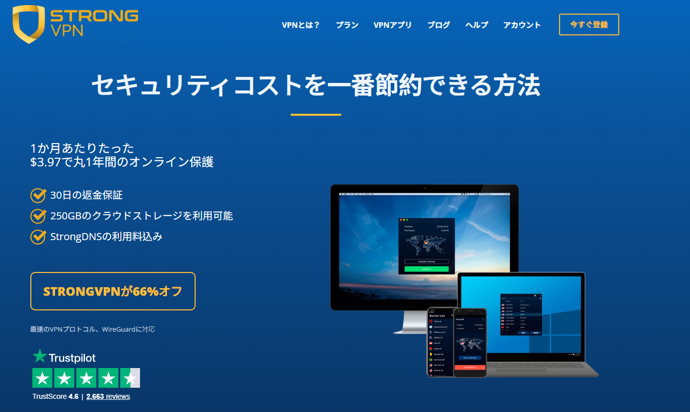

#### Step 2: アプリインストール
ダウンロードしたファイル実行 → 権限許可（ネットワークコンポーネントインストールに「はい」）。  
スタートアップで起動するかは任意。  

#### Step 3: ログイン
登録時のメール・パスワード入力。  

#### Step 4: 接続
「Best Available Location」で自動選択するか、必要な国を手動で選びます。日本、米国西海岸、米国東海岸などの性能は出発地で変わるため、同じ端末と時間帯で確認してください。「Connect」を押した後、IPとDNSも確認します。

### ExpressVPN インストール手順
アプリの案内と端末別サポートへ追加料金を払う候補です。自分のOSで必要な機能があるか確認します。

#### Step 1: 購入＆アクティベーションコード取得
公式ページはこちら：[ExpressVPN Offer](https://www.expressvpn.com/jp/top/country/japan-vpn?xvcid=yKMwqFWTfxyKWsB3AWwmhXdXUkpXYnRgxWVX3Q0&shareid=&irclickid=yKMwqFWTfxyKWsB3AWwmhXdXUkpXYnRgxWVX3Q0&irgwc=1&afsrc=1) → 購入後ダッシュボードでアクティベーションコード確認。  
Mac例：[公式Macページ](https://www.expressvpn.com/vpn-software/vpn-mac)からDL（自動検知）。  

#### Step 2: インストール
.pkgファイルを開き、表示内容を確認しながらインストールを進めます。ネットワーク構成の追加を求められた場合は、公式アプリであることを確認して許可します。

#### Step 3: ログイン
アプリ起動 → メール/パスワードorコード貼り付け。  
MacはIKEv2設定許可ポップアップ出るのでOK。  
  

#### Step 4: 接続
電源ボタンから「Smart Location」を使うか、必要な国を手動で選びます。接続表示だけで終わらず、IP、DNS、目的の動画やアプリ、再接続を確認します。同時接続上限は契約プランの現在の表示を確認してください。

### Surfshark インストール手順
同時接続無制限を実際に使う家庭向けの候補です。端末ごとの対応機能は公式一覧で確認します。

#### Step 1: ダウンロード＆インストール
購入後公式サイト/ダッシュボードからDL → インストーラー実行 → 各権限「はい」。  
  

#### Step 2: ログイン
アプリ開いて登録メール・パスワード入力。  

#### Step 3: 接続
「Quick-connect」かサイドバーから選択（Fastest Serverで自動）。  
「Connected」表示後にIP、DNS、目的のアプリを確認します。

### FlowVPN インストール手順
短期トライアルで確認できます。開始前に、画面へ表示される正確な期間、試用後の請求額、解約期限を確認してください。

#### Step 1: ダウンロード
登録/トライアル後、公式サイトから（Windows例）。  

#### Step 2: インストール＆接続
インストーラー実行 → セットアップ完了 → アプリ起動 → トライアルのログイン情報入力 → 「Connect」クリックで国/サーバー選択。  
「FlowVPN connected」表示後にIP、DNS、目的のアプリを確認します。

## VPNでできるようになること＋大事な注意点

VPNは端末からVPNサーバーまでの通信を暗号化し、接続先から見えるIPアドレスを変えます。旅行先の公共Wi-Fiや、別地域のサービスを確認する時に役立つ場合があります。ただし、アカウント地域、決済、GPS、サービス規約、マルウェア対策まで自動的に解決するものではありません。

下の一覧は確認対象の例であり、VPNによるアクセスや利用権を保証するものではありません。各サービスの提供地域、契約、規約を確認してください。

**カテゴリ別おすすめサイト早見表**

| カテゴリ              | オプション1                     | オプション2                  | オプション3                     | オプション4                | オプション5                |
|-----------------------|---------------------------------|------------------------------|---------------------------------|----------------------------|----------------------------|
| 動画ストリーミング     | [Netflix](https://www.netflix.com/) | [Hulu](https://www.hulu.com/) | [Amazon Prime Video](https://www.primevideo.com/) | [BBC iPlayer](https://www.bbc.co.uk/iplayer) | [Disney+](https://www.disneyplus.com/) |
| 音楽ストリーミング     | [Spotify](https://www.spotify.com/) | [Pandora](https://www.pandora.com/) | [Apple Music](https://www.apple.com/apple-music/) | [Tidal](https://tidal.com/) | [SoundCloud](https://soundcloud.com/) |
| 学術/研究             | [Google Scholar](https://scholar.google.com/) | [arXiv](https://arxiv.org/) | [IEEE Xplore](https://www.ieee.org/) | [JSTOR](https://www.jstor.org/) | [PubMed](https://pubmed.ncbi.nlm.nih.gov/) |
| 検索エンジン          | [Google](https://www.google.com/) | [Bing](https://www.bing.com/) | [DuckDuckGo](https://duckduckgo.com/) | [Yahoo](https://www.yahoo.com/) | [Startpage](https://www.startpage.com/) |
| 漫画/アニメ           | [Marvel Unlimited](https://www.marvel.com/unlimited) | [DC Universe](https://www.dcuniverse.com/) | [ComiXology](https://www.comixology.com/) | [Crunchyroll](https://www.crunchyroll.com/) | [Webtoon](https://www.webtoons.com/) |
| 国際ニュース          | [CNN](https://www.cnn.com/) | [BBC](https://www.bbc.com/) | [Wall Street Journal](https://www.wsj.com/) | [The Guardian](https://www.theguardian.com/) | [Al Jazeera](https://www.aljazeera.com/) |
| オンライン講座        | [Coursera](https://www.coursera.org/) | [edX](https://www.edx.org/) | [Khan Academy](https://www.khanacademy.org/) | [Udemy](https://www.udemy.com/) | [LinkedIn Learning](https://www.linkedin.com/learning/) |
| SNS                   | [Facebook](https://www.facebook.com/) | [Instagram](https://www.instagram.com/) | [Twitter/X](https://twitter.com/) | [LinkedIn](https://www.linkedin.com/) | [Pinterest](https://www.pinterest.com/) |

**大事な注意点＆ベストプラクティス**：
- 利用する国の法律と各サービスの規約を確認する
- 運営者やプライバシー条件が分からないサーバーへ、銀行・仕事・主要アカウントの通信を預けない
- キルスイッチと自動接続は、自分のOSで挙動を確認してから使う
- 速度、再接続、目的のアプリを同じ条件で確認する
- P2Pはプロバイダーの規約と合法的な用途の範囲で利用する
- 更新前にアカウント内の更新価格と現在の公式条件を確認する

VPNを契約したら、まず普段使う動画配信、メール、銀行アプリ、仕事用サービスで問題なく動くか確認しましょう。  
安全性と速度のバランスを見ながら、自分の環境で一番安定する設定を選んでください。  
端末ごとの細かい設定は、公式サポートページもあわせて確認してください。

### VPNで制限回避するのは違法？
VPNに関する法律、規制、認可制度は国や時期で異なります。VPNが一般に利用されている国でも、VPNを使って行う行為やサービス規約は別に判断されます。渡航前に政府・公的機関・勤務先の最新情報を確認し、現地法とサービス規約に従ってください。

公式サイトやアプリストアへアクセスしにくい渡航先では、出発前に公式アプリの導入、ログイン、更新、二段階認証を済ませます。法律上のリスクを「ほぼゼロ」とは断定しません。

## 無料VPNを選ぶ前に確認すること

無料というだけで危険とは限りません。公式の無料プラン、オープンソースのクライアント、匿名の無料サーバーは別物です。次の項目を確認します。

- 運営会社と収益モデルが明確か
- データ上限、サーバー選択、端末数、動画対応などの制限
- アプリの配布元、署名、更新履歴
- 収集するアカウント・診断・利用データ
- サポートと障害時の連絡先

運営者が分からない公開サーバーや非公式APKは、銀行、仕事、主要アカウントには使わないでください。公式の無料プランで足りる場合は無理に有料へ移る必要はなく、特定地域、動画、多数端末、サポートが必要になった時に有料を比較します。

## 自前VPN（自分でサーバーを立てる）の現実

VPSへOpenVPNやWireGuardを構築すると、サーバー運営者を自分で管理できる利点があります。一方、OS更新、鍵、ファイアウォール、監視、バックアップ、障害対応も自分の責任です。

固定IPが必要な仕事や自宅アクセスには向く場合がありますが、多数の国を切り替える用途や動画サービスでは、単一VPSのIPが目的を満たすとは限りません。必要な国、保守時間、VPSと通信量の費用を商用VPNと比較してください。

## 日本向けVPNの基本知識

日本語でVPNを探している読者の多くは、難しい技術解説よりも「自分の状況で本当に使えるか」を知りたいはずです。このページでは、海外から日本の動画を見る、日本から海外サービスを使う、旅行先やカフェのWi-Fiを安全に使う、という3つの用途を中心に比較します。

#### VPNでできること

- 海外滞在中に、日本の動画配信・ニュース・会員サイトへ安全にアクセスしやすくする
- 日本から海外のNetflix、Disney+、スポーツ配信などを試すときの選択肢を増やす
- 空港、ホテル、カフェ、学校、職場のWi-Fiで通信内容を保護する
- IPアドレスや位置情報の見え方を切り替え、価格・表示コンテンツ・ログイン判定の違いを確認する

#### 日本の読者が見るべき比較ポイント

| 比較ポイント | なぜ重要か |
| --- | --- |
| 日本サーバーの安定性 | 海外からTVer、ABEMA、U-NEXT、Hulu Japanなどを試すときに重要 |
| 米国・英国サーバーの速度 | Netflix、Disney+、Hulu、スポーツ配信など海外サービスで重要 |
| Fire TV / Apple TV / ルーター対応 | テレビで見る読者はスマホアプリだけでは足りないことがある |
| 返金保証 | 配信サービスは時期やサーバーで結果が変わるため、短期間で実機テストしたい |
| 日本語サポート・設定の簡単さ | VPN初心者が途中で離脱しないために重要 |

#### このページの使い方

1. まず用途を決める。海外から日本の動画、日本から海外配信、旅行Wi-Fi、仕事用のどれかを選ぶ。
2. 表の上位VPNを1つ選び、返金期間中に自分の端末と回線で試す。
3. 動画目的なら、1つのサーバーだけで判断せず、日本・米国・英国など複数サーバーで確認する。
4. 使えたサーバー名、曜日、時間帯をメモする。配信サービスは混雑時間帯で結果が変わることがある。

### 高度なVPN活用法＆メリット

#### ダブルホップ（マルチホップ）VPN – 使い方とその理由

ダブルホップ（またはマルチホップ）VPNは、通信を**2つ以上のサーバー**経由にする仕組み。  
流れはこう：あなた → サーバー1 → サーバー2 → インターネット。  
一層の保護が増えるけど、速度はちょっと落ちる（10〜30%くらい）。

**主なメリット**
1. **プライバシー＆匿名性が格段にアップ**  
   本当のIPは最初のサーバーに隠されるから、2番目のサーバーがハックされたり法的要請来ても、あなたのIPは見えない。  
   追跡が極めて難しくなる。

2. **監視・漏洩に対する追加防御**  
   高リスクな場面で最適：カフェ・空港・ホテルの公衆Wi-Fiで機密データ扱う時、監視地域でのジャーナリズム、ISP/政府ログを極限まで嫌う人。  
   片方が落ちても、もう片方で守ってくれる。

3. **厳しいネットワーク環境での接続安定性を強化**  
   企業ネットワークや通信制限が厳しい地域では、複数の接続手段を持っておくと復旧しやすくなります。

**設定の仕方**
- **アプリ内蔵型**：プロバイダーがMultiHop、Secure Core、Double VPNなどを提供している場合は、公式機能として利用します。
- **手動チェーン**：複数のVPNアプリを重ねると、経路、DNS、キルスイッチが競合する場合があります。公式サポートが案内しない構成は避けます。
- **向いている場面**：単一のVPNサーバーへ経路を集約したくない場合。
- **トレードオフ**：遅延と速度低下が増えるため、VPNなし・通常接続・マルチホップを同じ条件で比較します。

#### VPNがネット速度に与える影響

VPNは暗号化と追加経路を使うため、遅延が増えたり速度が下がったりする場合があります。一方、通常経路の混雑を避けて改善する場合もあるため、VPNなしの基準値と比較します。

**遅くなる主な原因**
1. **暗号化のオーバーヘッド**  
   暗号化と復号には端末の処理が必要です。影響は端末性能、プロトコル、実装で変わります。

2. **サーバーまでの距離**  
   遠いサーバーは一般に遅延が増えますが、実際のネットワーク経路も影響します。まず近いサーバーを試し、目的地が別地域ならその経路も比較します。

3. **サーバーの混み具合・品質**  
   ピークタイムの人気サーバーは遅い。  
   自動選択が常に最速とは限りません。自動選択と同じ国の別サーバーを比較します。

4. **元々の回線**  
   Wi-Fi干渉、古いルーター、混雑など元回線の問題はVPNでも残ります。VPNなしの測定を先に行います。

**このページで今後そろえる測定**
- VPNなしの元回線
- 米国西海岸→東京、米国東海岸→東京、欧州→東京
- 同じ端末、プロトコル、時間帯でのPing・ダウンロード・アップロード
- 切断後の再接続と20分の動画再生

この条件がそろうまでは、特定の速度低下率や東京までの実測値を断定しません。

**速度損失を最小限にするコツ**
- WireGuardやLightwayなど、利用できる方式を同じ条件で比較する
- 自動選択と近いサーバーを比較する
- 同じ測定ツールでVPNなし・VPNありを続けて測る
- Wi-Fi、有線LAN、ルーターの状態を確認する

必要な速度を満たすかは、自分の元回線と用途で判断します。最大値より、混雑時間の安定性、Ping、再接続、目的のアプリを優先してください。

#### 配信サービスでVPNが使えない時の確認ポイント

動画サービスは一部のVPN IPを定期的にブロックします。接続できない場合は、VPNそのものが失敗というより、サーバー選び・DNS・ブラウザキャッシュ・アプリ側の位置情報が原因のことがあります。

- 同じ国の別サーバーに切り替える
- ブラウザのキャッシュを消す、または別ブラウザで試す
- DNS漏れとWebRTC漏れを確認する
- スマホアプリの場合は位置情報権限を確認する
- まず1本を返金・試用期間中に確認し、失敗した条件が明確な場合だけ次の候補と同条件で比べる

日本向けの比較では、難しい回避ツールよりも、主要VPNアプリでどの動画サービスを安定して見られるかを重視します。

## 高度なVPN活用＆互換性

### VPN契約を定期的に見直す方法

数か月ごとに事業者を変えるだけでプライバシーが高まるとは限りません。更新前に、価格、用途、公式ポリシー、監査、アプリの保守状況を見直します。

**見直し手順**
1. **更新日を確認する**：次回請求額と解約期限を記録します。
2. **現在の資料を確認する**：必要な地域、端末、プライバシーポリシー、監査、サポート状況を見直します。
3. **古いVPN完全削除**  
   - アプリアンインストール  
   - 設定/プロファイル削除  
   - デバイス再起動で残骸クリア
4. **変更する場合は実際の用途で確認**
   - speedtest.netで速度  
   - ipleak.net/dnsleaktest.comで漏れなし  
   - ストリーミング/ゲーム/安定性数日テスト
5. **不要な重複契約を避ける**：明確な別用途がない限り、複数の長期契約を同時に維持しません。

現在のVPNが用途、価格、プライバシー条件を満たしているなら、変更そのものを目的にする必要はありません。

### FlowVPNのApple TV対応を確認する

FlowVPNのApple TV対応は、提供地域、tvOSのバージョン、公式アプリの配布状況によって変わります。公式アプリを利用できる場合はルーター設定を省けますが、古いTestFlight記事や期限切れの招待だけを根拠に購入しないでください。

**購入前に確認する点**
- 日本のApp Storeで現在の公式アプリが表示されるか
- 利用中のApple TVとtvOSが対応しているか
- 実際に使う動画サービスでログインと再生ができるか
- PayPalの試用後請求額と解約期限を確認したか

**Apple TVで確認する手順**
1. 現在のFlowVPN公式サポートで、利用中のtvOSと地域に対応する正式なインストール方法を確認します。
2. App Storeで公式アプリが表示される場合は、開発元を確認してインストールします。古いTestFlight招待や期限切れのベータ手順は使いません。
3. [FlowVPN – 短期トライアル](https://www.flowvpx.com/sign-up/?locale=ja-jp&special=FREETRIAL&r=35-890485.w_github)を開始する前に、正確な試用期間、PayPalの試用後請求額、解約期限を確認します。
4. 実際に使う動画アプリでログイン、再生開始、字幕、20分以上の安定性を確認します。

Apple TVアプリの提供状況と手順は変わるため、古いベータ記事より現在の公式案内を優先してください。

## VPNでNetflixを世界中で見る方法 – 2026年現在のリアル状況

Netflixのライブラリは国と作品の配信権によって異なります。VPNの接続先を変えても、アカウント、決済、端末、サービス側の判定が残るため、別地域の作品を必ず視聴できるわけではありません。

Netflixは年々VPN検知を強化中（IPブラックリスト・行動分析など）。  
NetflixはIPだけでなく、アカウント地域、決済地域、端末情報も確認するため、どのVPNも常時視聴を保証できません。まず実際の端末で再生し、失敗したら同じ国の別サーバー、アプリ再起動、ブラウザ版の順で確認します。

| VPNプロバイダー | 返金・試用期間中に確認する地域                  | 判断ポイント |
|-----------------|-------------------------------------------------------------|--------------------------|
| StrongVPN       | US、UK、ドイツ、日本、カナダ、オーストラリア                | 1年料金を抑えて実機確認する最初の候補 |
| ExpressVPN      | US、カナダ、UK、フランス、日本、オーストラリア、ドイツ、ブラジル | アプリとサポートに追加料金を払うプレミアム候補 |
| Surfshark       | カナダ、オーストラリア、日本、ドイツ、US、UK、オランダ       | 無制限接続を家族の端末で実際に使う場合の候補 |
| FlowVPN         | US、カナダ、UK、オーストラリア、日本、ドイツ                | 短期トライアルで端末と地域の相性を確認する候補 |

**確認手順**：
- まず目的地域の近いサーバーを選ぶ
- 失敗したら同じ国の別サーバー、ブラウザ、アプリの順に確認する
- 無料・有料にかかわらず、運営者、サーバー、データ上限、プライバシー条件を確認する

### VPNでDisney+を世界中で見る – 2026年現状
Disney+も地域で作品と権利が異なります。VPNの接続先を変えても、アカウント、決済、端末の地域判定が残ることがあり、視聴は保証されません。返金期間中に目的の作品と端末を確認してください。

| VPNプロバイダー | 返金・試用期間中に確認する地域                  | 判断ポイント |
|-----------------|-------------------------------------------------------------|--------------------------|
| StrongVPN       | UK、US、南アフリカ、オーストラリア、カナダ、ドイツ         | 低い初年度費用で目的の端末を試す候補 |
| ExpressVPN      | フランス、US、オーストラリア、カナダ、UK、日本、ドイツ     | アプリ品質とサポートを重視する高価格候補 |
| Surfshark       | US、UK、カナダ、オーストラリア、日本、オランダ、フランス   | 多数端末で同時に確認したい家庭向け |
| FlowVPN         | US、UK、ドイツ、オーストラリア、日本、カナダ                | 短期トライアルの条件とApple TVの現在の対応方法を確認 |

**Netflix＆Disney+共通の確認方法**：
- WireGuard、Lightway、OpenVPNなど利用できる方式を同じ回線で比較する
- キルスイッチの対象範囲と再接続を確認する
- 実際に使う端末でログイン、再生、字幕、20分の安定性を確認する
- 失敗したら同じ国の別サーバーを試し、短時間に国を何度も変えない

速度グラフは回線傾向の比較であり、各配信サービスの常時解除を保証するものではありません。1年料金ならStrongVPN、プレミアムな使いやすさならExpressVPN、多数端末ならSurfshark、短期確認ならFlowVPNの順で比較します。
視聴可否は変化するため、比較表より同日の実機結果を優先してください。

## VPNプロトコルの選び方

VPNアプリにはWireGuard、OpenVPN、IKEv2など複数の接続方式があります。初心者はまずアプリの「自動」設定で問題ありません。速度が遅い、動画が止まる、特定のWi-Fiで接続できない場合だけ、プロトコルを切り替えて比較します。

| プロトコル | 向いている用途 | 注意点 |
| --- | --- | --- |
| WireGuard / Lightway系 | 速度重視、動画、スマホ利用 | 一部のネットワークでは別方式の方が安定することがある |
| OpenVPN UDP | 速度と安定性のバランス | 混雑回線では速度差が出やすい |
| OpenVPN TCP | ホテル・学校・職場Wi-Fiなど制限が強い場所 | 速度は落ちやすいが接続できる可能性が上がる |
| IKEv2 | スマホの回線切り替え | 対応状況はVPNアプリによって違う |

動画目的なら、プロトコルだけでなくサーバーの混雑、DNS漏れ、WebRTC、ブラウザキャッシュも確認してください。日本向けの読者には、細かい技術名よりも「同じ条件で2〜3本のVPNを短期間に試す」方が実用的です。

### VPN vs Tor – 違いと使い分け

**VPN**と**Tor**（The Onion Router）は、どちらも通信経路を変えるツールですが、目的と信頼モデルが異なります。

#### 1. VPN：端末からVPNサーバーまでの暗号化と経路変更
- 端末とVPNサーバー間の通信を暗号化する
- 接続先から見えるIPアドレスをVPNサーバーのものに変える
- サービスの地域判定へ影響する場合があるが、視聴や利用を保証しない
- VPN事業者を信頼する構造になるため、ポリシー、監査、管轄を確認する
- 速度低下はプロトコル、距離、混雑、回線で変わる
- 日常の公衆Wi-Fi、リモート接続、特定地域への接続確認に使われる

#### 2. Tor：複数中継による匿名性の強化
- 通常は複数のボランティア中継（エントリー、ミドル、出口）を通る
- 匿名性：Torは複数中継を使いますが、ログインや端末識別まで自動的に消えるわけではありません
- ダークウェブ（.onionサイト）アクセス可能
- デメリット：多重経路のため遅くなりやすく、動画やビデオ通話には向きにくい。HTTPSも引き続き重要

**どっち選ぶ？**
- **VPN**：速度・ストリーミング・ゲーム・日常プライバシー重視
- **Tor**：単一VPN事業者へ経路を集約したくない場合や、高い匿名性が必要な用途
- 併用派も多い：日常VPN＋敏感作業はTor Browser

脅威モデルと用途で選びましょう。一般的な公衆Wi-Fi保護と、高リスク環境で必要な匿名性は同じ要件ではありません。

### VPN vs プロキシサーバー – 決定的な違い
VPNとプロキシはどちらも通信経路を変えられますが、暗号化と保護範囲が異なります。

#### 1. 仕組み
- **VPN**：対応する端末通信をVPNサーバーへ通し、その区間を暗号化する
- **プロキシ**：設定したアプリやブラウザの通信を中継する。暗号化の有無は方式による

#### 2. セキュリティ＆プライバシー
- **VPN**：公衆Wi-Fiで端末とVPNサーバー間の通信保護に役立つ
- **プロキシ**：方式によっては暗号化しないため、運営者と設定を確認する必要がある

#### 3. 速度＆性能
- **VPN**：暗号化と経路の追加で速度が変わる。WireGuardは効率を重視する場合の候補
- **プロキシ**：軽い場合もあるが、公開プロキシは混雑、運営者、ログの確認が必要

**結論**：端末全体の通信保護にはVPN、特定アプリの単純な経路変更にはプロキシという違いがあります。目的と運営者の信頼性で選んでください。

## よく使われるVPNプロトコル解説

VPNはデバイスとサーバー間に安全な暗号化トンネル作って、監視・干渉をブロック。  
プロトコルによって速度・セキュリティ・互換性が違うので、知っておくと便利。

- **PPTP**：最古で一番簡単・どこでも動くけどセキュリティ弱すぎ（敏感作業はNG）
- **L2TP/IPsec**：PPTPよりセキュリティ強化、ビジネス定番（セットアップ少し面倒）
- **SSTP**：強力暗号化＋速い、Windowsユーザー向き（Microsoftバックアップ）
- **IKEv2/IPsec**：モバイル回線の切り替え後に再接続しやすい場合がある
- **OpenVPN**：広く利用されているオープンソース方式。UDP/TCPの選択肢と対応端末を確認します。
- **WireGuard**：比較的軽量な設計。実際の速度と安定性は、アプリ実装、回線、サーバーで確認します。

**プロTips**：アプリは自動で最適選んでくれるけど、ゲーム/ストリーミングならWireGuard優先、セキュリティ最優先ならOpenVPN。

## ゲームで確認するVPNの経路・Ping・安定性

グローバルゲーム時代、サーバー制限・高ping・ネットワークフィルター・ジオブロックが敵。  
VPNはIP保護や経路変更に役立つ場合がありますが、暗号化と距離でpingが増える場合もあります。実際のゲーム、回線、時間帯でVPNなしの場合と比較してください。

ゲーム用途ではStrongVPNを料金から、ExpressVPNをアプリとサポートから比較します。遅延は距離、経路、混雑、ゲームサーバー地域で変わります。

### VPNで確認できることと限界
- **経路の違い**：ISPの通常経路より安定する場合もあれば、暗号化と迂回で遅くなる場合もあります。
- **Pingとパケットロス**：VPNなし、近いVPNサーバー、目的地域のVPNサーバーを同じ時間帯に比較します。
- **IPアドレスの分離**：接続先から見えるIPはVPNサーバーのものになりますが、アカウントや端末情報まで隠れるわけではありません。
- **公共Wi-Fi**：端末とVPNサーバー間の通信保護に役立ちますが、フィッシングやアカウント盗難を自動的に防ぐものではありません。
- **利用条件**：地域価格、イベント、マッチメイキングへの利用は、ゲームの規約とアカウント条件を確認してください。

### StrongVPNとExpressVPNをゲーム用途で比較する理由
- **StrongVPN**：WireGuardなどを選択でき、1年料金と実際のゲーム経路を比較しやすい候補です。まず返金期間中にPing、パケットロス、切断後の復帰を確認します。
- **ExpressVPN**：LightwayやSmart Locationを利用でき、アプリの案内とサポートへ追加料金を払う意味がある場合の2番手です。サーバー数だけで低遅延を判断しないでください。

ゲーム用途では、返金期間中にVPNなしとのPing差、パケットロス、切断頻度、再接続を確認し、改善しない場合は使わない判断も必要です。

- [StrongVPNをまず試す](https://strongvpn.com/jp/?tr_aid=60d96b5810e50&chan=w_github_jp&data1=jp-home&data2=title)
- [ExpressVPNを次に比較する](https://www.expressvpn.com/jp/top/country/japan-vpn?xvcid=yKMwqFWTfxyKWsB3AWwmhXdXUkpXYnRgxWVX3Q0&shareid=&irclickid=yKMwqFWTfxyKWsB3AWwmhXdXUkpXYnRgxWVX3Q0&irgwc=1&afsrc=1)

※このリンク経由で購入すると運営側に手数料が入る場合があります。順位は StrongVPN → ExpressVPN → Surfshark → FlowVPN の順で、価格・契約期間・用途の違いも明記しています。

ゲーム用途では速度だけでなく、Ping、切断頻度、利用規約との相性も確認してから使い続けてください。

## 詳細VPN速度リファレンス（毎日更新 – 2026年11月20日）

### 地域別VPN速度テスト
下のグラフは、4社を同じ形式で見比べるための地域別リファレンスです。東京や特定都市を同条件で測った結果ではありません。実際の速度は、元回線、出発地、VPNサーバー、目的地、時間帯、混雑、プロトコルで変わります。

**今後必要なテスト：** 米国西海岸→東京、米国東海岸→東京、欧州→東京を、同じ端末・プロトコル・時間帯で比較します。VPNなしの基準値、VPN接続時のPing・ダウンロード・アップロード、再接続、20分の動画再生を記録するまでは、都市別の性能を断定しません。

### 大陸別接続リファレンス
この図は各社を地域別に見比べるためのプロジェクト資料です。国、都市、ISPごとの現在の接続成功率を保証するものではありません。自分の回線で接続、切断、再接続を繰り返し、必要なアプリが動くかを確認してください。

### ネットワーク別詳細速度（4G/5G/Wi-Fi）

以下は4G、5G、Wi-Fiを比較するための参考シナリオです。各通信会社や公共Wi-Fiの実測値ではないため、自分のVPNなしの基準値と比較して利用してください。

#### StrongVPN – ネットワーク別速度
StrongVPNを最初に試す場合も、この表の数値ではなく、自分の回線で同じ時間帯に測った結果を優先します。

| 地域            | StrongVPN 4G | StrongVPN 5G | StrongVPN Wi-Fi |
|-----------------|--------------|--------------|-----------------|
| 北米            | 60           | 63           | 60              |
| 欧州            | 78           | 78           | 77              |
| オセアニア      | 55           | 58           | 59              |
| アジア          | 74           | 72           | 75              |
| 中米            | 48           | 46           | 48              |
| 南米            | 50           | 51           | 52              |
| アフリカ        | 46           | 46           | 49              |

#### ExpressVPN – ネットワーク別速度
ExpressVPNはアプリとサポートに追加料金を払う候補です。現在このページには同条件のネットワーク別実測表がないため、StrongVPNより安定すると断定しません。

#### Surfshark – ネットワーク別速度
無制限デバイスは家族利用に便利ですが、どの経路でも低遅延になる保証ではありません。

現在このページには同条件のネットワーク別実測表がありません。多数端末を同時に使う家庭で、各端末の速度と切断を確認してください。

#### FlowVPN – ネットワーク別速度
短期トライアルで回線との相性を確認する候補です。正確な試用期間、試用後の請求額、解約期限を開始前に確認してください。現在このページには同条件のネットワーク別実測表がありません。

**まとめ**：この資料だけでは4社の都市別順位は決まりません。1年料金ならStrongVPN、アプリとサポートならExpressVPN、多数端末ならSurfshark、短期確認ならFlowVPNという役割から選び、同じ条件で確認します。

### Step 3: 実際の配信アプリで確認する
VPN接続後に、Netflix、Disney+、YouTube、Huluなど目的のアプリを開きます。ログインだけで判断せず、作品検索、再生開始、画質、字幕、20分の連続再生まで確認してください。失敗した場合は同じ国の別サーバー、アプリ再起動、Cookieや位置情報の確認を行い、解決しなければ返金・試用期限内にサポートへ連絡します。

## Netflix & HuluがVPNをどう検知・ブロックしてるか

NetflixやHuluはライセンス契約で国ごとにコンテンツ制限をかけているため、  
VPNやプロキシと判断された接続を制限する場合があります。判定方法は公開されていない部分も多いため、一般的に確認すべき要素を整理します。

#### 1. IPアドレス検知
公開データセンターのVPNサーバーIPを大量ブラックリスト化。  
同じIPから大量接続が来たら「プロキシエラー」または「地域外」表示になります。

#### 2. 行動パターン・IP分布分析
同じIPから数百・数千接続、場所不一致（US IPなのに支払い国が日本など）、異常トラフィック量で怪しいと判定。

#### 3. ポート・プロトコル指紋
OpenVPNのポート1194など特定ポート、プロトコルシグネチャを検知。  
ディープパケットインスペクションで443（HTTPS）でもVPNっぽさを検出。

#### 4. DNS漏れ・WebRTCチェック
設定ミスのVPNはDNSリクエストやWebRTCで本当のIPを漏らす → 即バレ。

有料VPNでも再生を保証できません。サーバー変更、DNS/IP確認、アプリ再起動、サポート案内で解決する場合はありますが、目的のサービスを同じ日に実機で確認する必要があります。StrongVPNは1年料金から先に試し、ExpressVPNはアプリやサポートへ追加料金を払う意味がある場合に比較します。

## Netflix & Disney+接続リファレンス

### Netflix大陸別接続リファレンス

この図は4社を大陸別に並べたプロジェクトの比較資料です。Netflixの現在の都市別成功率や、特定ライブラリの再生を保証するものではありません。目的の作品、アカウント、端末で20分以上再生して確認してください。

### Disney+大陸別接続リファレンス

Disney+についても、この図は比較用のリファレンスです。米国東海岸、米国西海岸、東京の特定サーバーが現在利用できることは示していません。ログイン、作品一覧、再生、字幕、20分の安定性を同じ端末で確認してください。

## LinuxでのVPNインストールガイド

### Linux vs WindowsのVPN体験 – 決定的な違い

VPNはどのOSでもセキュリティ・プライバシー・アクセス向上してくれるけど、  
LinuxとWindowsでは使い心地が結構違う。

#### ユーザー体験
- **Windows**：多くのプロバイダーがGUIアプリ、キルスイッチ、サーバー一覧を提供します。スプリットトンネルの対応は各社で確認してください。
- **Linux**：GUI、CLI、OpenVPN/WireGuardの手動設定など、プロバイダーとディストリビューションで導入方法が異なります。初心者は公式対応状況を先に確認してください。

#### セキュリティ
- **Linux / Windows**：どちらもOS更新、公式アプリ、権限設定、キルスイッチの確認が必要です。OS名だけで安全性は決まりません。

#### 互換性＆サポート
- **Windows**：ほぼ全VPNが専用アプリあり。
- **Linux**：OpenVPN/WireGuard設定でExpressVPN・StrongVPN・Surfshark対応強い。  
  GUI、CLI、手動設定の現在の提供状況は公式ページで確認してください。

**結論**：Linuxは設定の自由度、Windowsは導入の分かりやすさが主な違いです。  
利用するディストリビューションが公式サポート対象か確認し、OSとVPNアプリを更新してください。

#### Linux設定を5ステップで確認
1. 価格重視ならまず**StrongVPN**、アプリの案内や安定性を優先するなら**ExpressVPN**を検討します。多数端末はSurfshark、短期確認はFlowVPN向きです。
2. プロバイダーの公式アカウントからLinuxアプリ、またはOpenVPN/WireGuard設定ファイルを取得します。
3. アプリをインストールするか設定ファイルを読み込み、VPNネットワークインターフェースの作成を許可します。
4. 速度重視ならWireGuard、ホテル・大学・社内ネットワークで接続できない場合はOpenVPN TCPを試します。
5. 公衆Wi-Fiで使う前にIP・DNS・キルスイッチを確認し、動画エラー時は同じ国の別サーバーへ切り替えます。

## VPNをブロック・制限するアプリ＆サービス

一部アプリ・サービスは著作権・詐欺防止・不正検知・品質管理でVPNを積極的にブロック。  
よくあるやつをまとめました：

1. **ストリーミングプラットフォーム**  
   - **Netflix/Hulu/BBC iPlayer/Disney+**：IPブラックリスト・行動分析・DNSチェックで検知。  
     対策：同じ国の別サーバー、ブラウザとアプリの切り替え、サポート案内を試します。どのVPNも常時再生は保証できません。

2. **銀行・金融サービス**  
   VPN IPを不審扱い（詐欺・場所偽装疑い）で追加認証・一時ロック・電話確認。  
   対策：スプリットトンネルで銀行アプリだけVPN外し、または本当の国サーバー接続。

3. **ゲームプラットフォーム**  
   - **Steam/Epic/Riot/Ubisoft**：チート・地域価格ハック・サーバー乱用防止で検知。  
     マッチング制限やアカウントフラグ。  
     対策：低ping近くサーバー、ランクプレイ時は避ける。

4. **SNSなど**  
   - **Facebook/Instagram/X**：IP頻繁変更・異常場所でCAPTCHA・追加ログイン・一時制限。  
     対策：1サーバー固定、スプリットトンネルでSNS外し。

**ブロック最小限のコツ**：
- ストリーミング/P2P最適サーバー使う
- 難読化/カモフラージュモードON
- サーバー回転は控えめに
- 非敏感アプリはスプリットトンネルでVPN外し
- ブロックされたらサポートに聞く（プレミアムは専用対策あり）

## BitTorrent＋VPN – 設定とベストプラクティス

BitTorrent（P2P）は大容量のファイル共有に使われますが、  
ピアに本当のIP丸見え → 法的通知・ISP絞り込み・プライバシーリスク大。  
VPNでIP隠し・通信暗号化・絞り込み防止。

### キー設定Tips
1. **P2P対応VPN選ぶ**  
   ポートブロック・ログ取るVPNはNG。  
   おすすめ：  
   - **Surfshark** → P2P対応範囲、無制限デバイス、WireGuardを公式情報で確認  
   - **StrongVPN** → P2P強い、同時12台  
   - **ExpressVPN** → P2P対応、アプリ、プライバシー資料を公式情報で確認

2. **キルスイッチを有効にしてテスト**
   VPNを意図的に切り、トレント通信が止まるか確認します。さらにトレントクライアントをVPNインターフェースへバインドすると、経路を限定しやすくなります。

3. **暗号化レベルバランス**  
   現行アプリの既定暗号化とプロトコルを利用します。  
   WireGuardで速度損失最小。

4. **スプリットトンネルで最適化**  
   qBittorrent/uTorrent/TransmissionだけVPN経由、他（ブラウザ・ゲーム）は通常回線で速度確保。

5. **ベストプラクティス**  
   - トレントクライアントをVPNインターフェースにバインド（漏れ防止）  
   - ポートフォワード対応なら使う（DL速くなる）  
   - 公開トラッカー避けてプライベート推奨  
   - ipleak.netでトレント中漏れチェック

**おすすめ**：**[ExpressVPN 公式オファーを確認](https://www.expressvpn.com/jp/top/country/japan-vpn?xvcid=yKMwqFWTfxyKWsB3AWwmhXdXUkpXYnRgxWVX3Q0&shareid=&irclickid=yKMwqFWTfxyKWsB3AWwmhXdXUkpXYnRgxWVX3Q0&irgwc=1&afsrc=1)**  
P2P最適・キルスイッチ・スプリットトンネル・グローバルサーバーで高速ピア。

## VPNのよくある限界と解決策

VPNは強力だけど完璧じゃない。  
主な弱点と実践的な対策まとめ。

1. **速度低下**  
   - 問題：暗号化＋ルーティングのオーバーヘッド  
   - 対策：WireGuard/Lightway＋近くサーバー＋高速元回線。  
     プレミアムなら5〜20%損失で済む。

2. **接続落ち・不安定**  
   - 問題：サーバー過負荷・ISP干渉・ネットワーク変更  
   - 対策：自動再接続＋キルスイッチON。  
     サーバー/プロトコル切り替え・24/7サポートで設定調整。

3. **デバイス/プラットフォーム互換性**  
   - 問題：Linux・ルーター・スマートTVでネイティブアプリ少ない  
   - 対策：OpenVPN/WireGuard設定対応プロバイダー選ぶ（ExpressVPN/Surfshark/StrongVPN）。  
     未対応デバイスは設定ファイルで対応。

4. **プライバシー懸念（ログ・管轄）**  
   - 問題：ログ取るor監視国拠点  
   - 対策：監査済みno-logs＋プライバシー優良国（BVI・スイス）。  
     最新監査/透明性レポート確認。

5. **ストリーミング/ゲームブロック**  
   - 問題：サービスがVPN IP検知  
   - 対策：難読化サーバー・IP回転・プロバイダー切り替え。  
     プレミアムは更新速い。

良いVPN＋これらの調整で、ほとんどの限界は小さなものに。  
返金保証期間中に実際の端末とサービスを確認し、条件に合うものだけを残してください。
